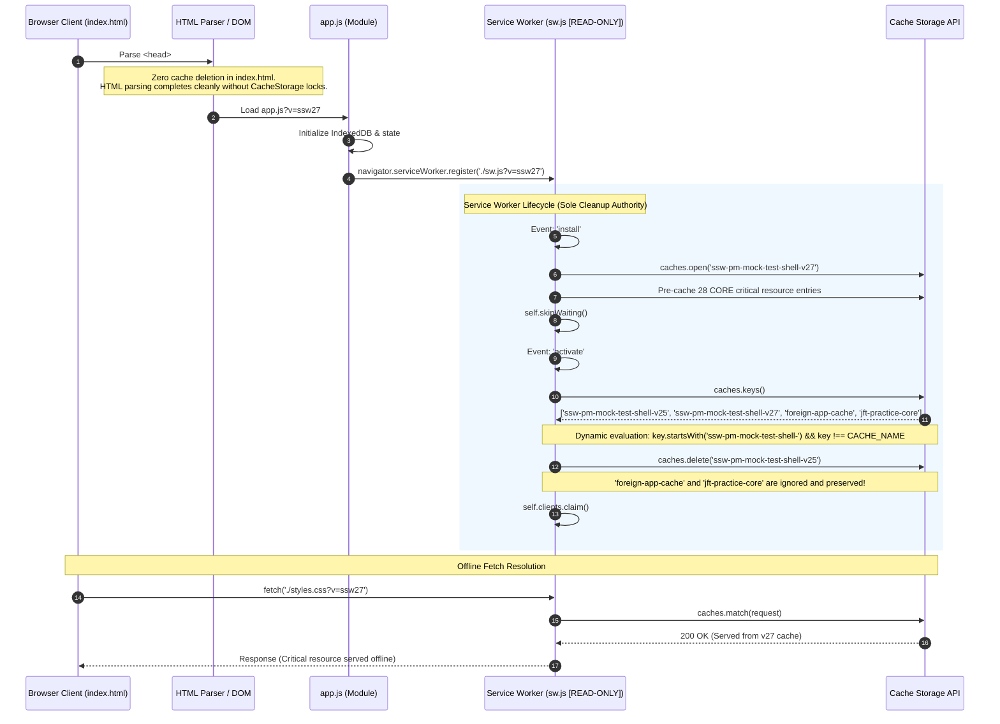

# Contract: Cache Governance & Multi-File Consistency Protocol (Refined)

**Feature**: `001-fix-pwa-cache-cleanup`<br>
**Date**: 2026-11-09 (Refined)<br>
**Status**: Ready for Implementation<br>
**Governing Standard**: Constitution v1.1.0 (Tier 3 Quality Gate)

---

## 1. Scope & Purpose
This contract establishes the formal architectural boundaries, roles, and consistency protocols between:
1. **Host HTML Document (`index.html`)**: Initial bootstrap thread.
2. **Main Application State Machine (`app.js`)**: Module initialization & SW registration.
3. **Service Worker Global Scope (`sw.js`)**: Read-only background thread managing pre-caching, fetch routing, and cache rotation.

---

## 2. Component Responsibility & Authority Matrix

| Component | Status in Feature 001 | Responsibility | Forbidden Actions |
|---|---|---|---|
| **`index.html`** | **Modified** | • Fast, pure document parsing.<br>• Load critical shell stylesheets and ES module `app.js`. | • **MUST NOT** invoke `caches.delete()` or inspect Cache Storage.<br>• **MUST NOT** contain hardcoded cache version identifiers or exception checks.<br>• **MUST NOT** delete unproven legacy caches (such as `jft-practice*`). |
| **`app.js`** | **Modified** | • Register Service Worker with URL synchronized to active shell version: `./sw.js?v=ssw27`.<br>• Manage offline UI state (`#connection-label`). | • **MUST NOT** manipulate cache buckets directly.<br>• **MUST NOT** register mismatched SW query versions (e.g. `?v=ssw26`). |
| **`sw.js`** | **READ-ONLY** | • **Sole Authority** for versioned shell cache deletion (`activate`).<br>• Pre-cache 28 CORE critical shell resource entries (`install`).<br>• Serve offline fallback from cache (`fetch`). | • **MUST NOT** be modified unless proven technically defective (already optimal).<br>• **MUST NOT** delete caches outside proven namespace `ssw-pm-mock-test-shell-`. |

---

## 3. Sequence & Lifecycle Protocol



---

## 4. Multi-File Consistency & Version Normalization Contract

### 4.1 Shell Version Mapping Convention
The active shell version integer `<N>` (currently `27`) maps deterministically across components as follows:
- **Cache Storage Container**: `ssw-pm-mock-test-shell-v<N>` (e.g., `ssw-pm-mock-test-shell-v27`).
- **Application Shell Asset Queries**: `?v=ssw<N>` (applied to shell components: `styles.css?v=ssw27`, `QUESTION-EDITOR-UPDATES.css?v=ssw27`, `ZEN-APP-SHELL.css?v=ssw27`, `HOME-DASHBOARD.css?v=ssw27`, `ZEN-PAGES.css?v=ssw27`, and `app.js?v=ssw27`).
- **Service Worker Registration Query**: `./sw.js?v=ssw<N>` (registered in `app.js`).

### 4.2 Independent Resource Versioning
Non-shell assets and utility modules maintain **independent version release cadences** and do NOT share the shell version `<N>`. This is by design:
- Data Layer & Utility Modules: `seed-data.js?v=ssw3`, `db.js?v=ssw3`, `utils.js?v=ssw3`, `archive.js?v=ssw3`, `CSV-IMPORT-STYLES.css?v=ssw3`, `RICH-HTML-STYLES.css?v=ssw3`.
- Manifest & Icon Assets: `manifest.webmanifest?v=ssw18`, `favicon.png?v=ssw18`, `icon.svg?v=ssw18`.
- Static JSON Bundles: Unversioned static files (e.g., `ssw-pm-kunci-ujian-1.json`).

### 4.3 Invariant Rules

```text
Let ACTIVE_VERSION = ExtractVersion(sw.js: CACHE_NAME) // e.g. "27" from "ssw-pm-mock-test-shell-v27"

Invariant 1 (Registration URL):
  app.js: navigator.serviceWorker.register('./sw.js?v=ssw' + ACTIVE_VERSION) MUST be true.

Invariant 2 (Shell Asset Link Queries):
  index.html & sw.js:CORE: Shell assets (styles.css, app.js, ZEN-*.css, HOME-*.css, QUESTION-*.css)
  MUST match query "?v=ssw" + ACTIVE_VERSION.

Invariant 3 (Zero Client-Side Deletion):
  index.html: MUST NOT contain "caches.delete" or any reference to "ssw-pm-mock-test-shell-".

Invariant 4 (Proven Namespace Deletion Only):
  sw.js: Deletion filter MUST strictly require key.startsWith('ssw-pm-mock-test-shell-') && key !== CACHE_NAME.
  All foreign or unproven keys (including 'jft-practice*') MUST remain untouched.
```
