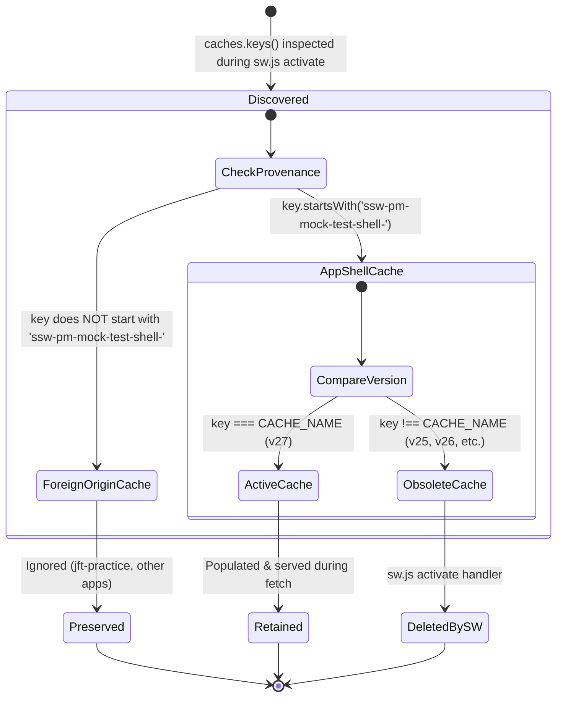

# Data Model & Storage Entities: Fix PWA Cache Cleanup Inconsistency (Refined)

**Feature**: `001-fix-pwa-cache-cleanup` 
**Date**: 2026-11-09 (Refined) 
**Status**: Ready for Implementation 
**Governing Standard**: Constitution v1.1.0 (Tier 3 Quality Gate)

---

## 1. Overview & Storage Scope
This feature operates strictly at the browser **Cache Storage API** layer (`window.caches` in the window thread, `self.caches` in the ServiceWorkerGlobalScope).

Per Constitution Principle II & VI, this feature:
- **MUST NOT** modify or touch IndexedDB database `ssw-pm-mock-test-db` or its object stores (`questions`, `themes`, `passages`, `sessions`, `meta`, `audioGroups`, `studyList`).
- **MUST NOT** modify `localStorage` keys (`zen_theme`, `zen_sound`, `zen_lang`, etc.).
- **MUST NOT** modify static question JSON files or session state schemas.

---

## 2. Cache Storage Entity Definitions & Provenance

### 2.1 Entity: Active Shell Cache Bucket (Proven Ownership)
The single authoritative cache container managed by `sw.js` for storing all static shell assets required for offline-first operation.

| Attribute | Specification | Example / Value |
|---|---|---|
| **Bucket Name / Key** | String following convention `ssw-pm-mock-test-shell-v<NUMBER>` | `ssw-pm-mock-test-shell-v27` |
| **Owner Authority** | ServiceWorkerGlobalScope (`sw.js`) | `sw.js` |
| **Lifecycle State** | `Active` (Populated during `install`, matched during `fetch`, retained during `activate`) | Active |
| **Contents** | Core shell resources (`index.html`, CSS files, JS modules, question bundles, icons) | 28 pre-cached CORE critical resource entries |
| **Eviction Policy** | Retained as long as it matches `sw.js:CACHE_NAME`. Evicted only when a newer SW activates. | Protected |

### 2.2 Entity: Obsolete Application Cache Bucket (Proven Ownership)
A legacy or superseded cache container created by previous versions of the SSW PM application.

| Attribute | Specification | Example / Value |
|---|---|---|
| **Bucket Name / Key** | Any cache key starting with prefix `ssw-pm-mock-test-shell-` where `key !== CACHE_NAME` | `ssw-pm-mock-test-shell-v25`, `ssw-pm-mock-test-shell-v26` |
| **Owner Authority** | Evicted exclusively by ServiceWorkerGlobalScope (`sw.js`) during `activate` | `sw.js` |
| **Lifecycle State** | `Obsolete` / `Pending Deletion` | Obsolete |
| **Eviction Policy** | Automatically deleted via `caches.delete(key)` during SW `activate`. | Dynamic deletion by SW only |

### 2.3 Entity: Foreign / Unrelated Same-Origin Cache Buckets (Unproven Ownership)
Cache containers owned by other applications, libraries, or projects sharing the same origin domain (`faizalart.github.io`). This explicitly includes any third-party caches (such as `jft-practice*`, `portfolio*`, `firebase-installations`, etc.).

| Attribute | Specification | Example / Value |
|---|---|---|
| **Bucket Name / Key** | Any key NOT starting with prefix `ssw-pm-mock-test-shell-` | `jft-practice-core`, `portfolio-v1`, `other-app-cache` |
| **Owner Authority** | External projects on the shared origin | External |
| **Lifecycle State** | `Foreign` / `Preserved` | Foreign |
| **Eviction Policy** | **STRICTLY PRESERVED / NEVER TOUCHED**. Must never be inspected or deleted by any script in this project. | Absolute protection |

---

## 3. Cache Storage State Transition Diagram

---

## 4. Key Lifecycle Rules & Invariants

1. **Single Deletion Authority**:
   - The Service Worker `activate` event is the **Sole Authority** for deleting obsolete versioned shell caches.
   - `index.html` has **ZERO** cache deletion logic.
2. **Provenance & Origin Isolation**:
   - Only cache keys with the exact namespace prefix `ssw-pm-mock-test-shell-` may be evaluated for deletion.
   - Unproven keys (including `jft-practice*`) are treated as foreign origin caches and **MUST NOT** be deleted.
3. **Multi-File Version Consistency**:
   - `sw.js:CACHE_NAME` defines the active version `N`.
   - `index.html` references assets with `?v=ssw<N>`.
   - `app.js` registers `./sw.js?v=ssw<N>`.
