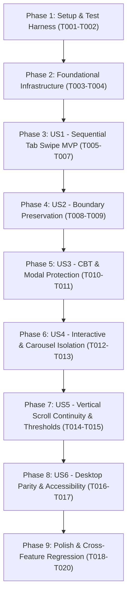

# Tasks: Feature 004 — Global Mobile Swipe Navigation Across All Main Tabs

**Input**: Design documents from `specs/004-global-swipe-tab-navigation/` (`spec.md`, `plan.md`, `research.md`, `data-model.md`, `contracts/swipe-navigation.md`, `quickstart.md`)
**Branch**: `feat/swipe-tab-navigation`
**Prerequisites**: Active branch strictly confirmed as `feat/swipe-tab-navigation`
**Organization**: Tasks are grouped by foundational infrastructure and user stories to enable independent implementation, rigorous verification, and zero regression.

---

## Format: `[ID] [P?] [Story] Description`

- **[P]**: Can run in parallel (different files, no dependencies)
- **[Story]**: Which user story this task belongs to (e.g., US1, US2, US3, US4, US5, US6)
- Exact file paths are included in all task descriptions

---

## Phase 1: Setup & Automated Test Harness Foundation

**Purpose**: Establish the automated testing harness and pre-flight governance assertions before code modification.

- [x] T001 Initialize automated CDP test harness structure in `tests/test-global-swipe-navigation.mjs` supporting Android mobile viewport (390×844) with touch emulation and Desktop viewport (1440×900).
- [x] T002 [P] Implement cache governance and Service Worker version (v27) invariant pre-checks in `tests/test-global-swipe-navigation.mjs`.

---

## Phase 2: Foundational Gesture Tracking Infrastructure

**Purpose**: Core constants, data structures, and helper functions that all user stories depend on.

- [x] T003 Define canonical `ORDERED_MAIN_TABS = ['home', 'setup', 'bank', 'history', 'study', 'backup']` and `SWIPE_CONFIG` threshold constants in `app.js` per `contracts/swipe-navigation.md`.
- [x] T004 Implement helper `getAdjacentMainTab(currentPage, direction)` and ephemeral session state structure in `app.js`.

**Checkpoint**: Foundation ready — User story implementation and regression test authoring can begin.

---

## Phase 3: User Story 1 - Continuous Full-Sequence Main Tab Swiping (Priority: P1) — MVP

**Goal**: Enable candidates to swipe left and right across any primary tab content to transition sequentially through all 6 main tabs (`home` ⇄ `setup` ⇄ `bank` ⇄ `history` ⇄ `study` ⇄ `backup`).
**Independent Test**: Swipe left sequentially from Beranda to Backup, then swipe right sequentially back to Beranda; verify that the active tab indicator and content update on each swipe.

- [x] T005 [P] [US1] Implement automated CDP test scenarios for full forward swipe sequence (`home` → `setup` → `bank` → `history` → `study` → `backup`) and reverse swipe sequence (`backup` → `study` → `history` → `bank` → `setup` → `home`) in `tests/test-global-swipe-navigation.mjs`.
- [x] T006 [US1] Implement passive touch lifecycle event handlers (`onTouchStart`, `onTouchMove`, `onTouchEnd`, `onTouchCancel`) and attach them to `document` with `{ passive: true }` in `app.js`.
- [x] T007 [US1] Connect gesture resolution to existing router `window.go(targetTab)`, ensuring active tab glider indicator and breadcrumbs synchronize immediately in `app.js`.

**Checkpoint**: User Story 1 is functional as an independent MVP.

---

## Phase 4: User Story 2 - Boundary Preservation and Non-Circular Dead-Ends (Priority: P1)

**Goal**: Ensure swiping right on the first tab (`home`) and swiping left on the last tab (`backup`) safely remains on the current tab without circular wrapping or layout shifts.
**Independent Test**: Initiate swipe right while on Beranda and swipe left while on Backup; verify that no page navigation occurs and no errors are thrown.

- [x] T008 [P] [US2] Implement automated CDP test scenarios asserting that swipe right on Beranda and swipe left on Backup remain on their respective pages in `tests/test-global-swipe-navigation.mjs`.
- [x] T009 [US2] Implement boundary dead-end checks in `getAdjacentMainTab()` to return `null` at terminal ends (`home` previous, `backup` next) without circular wrapping in `app.js`.

**Checkpoint**: User Stories 1 and 2 work reliably together with firm boundary stops.

---

## Phase 5: User Story 3 - Protection of Critical Assessment & Review Surfaces (Priority: P1)

**Goal**: Guarantee that active CBT exams (`exam`), Results scorecards (`result`), Review Answers (`review`), and active modal dialogs are completely exempt from swipe navigation.
**Independent Test**: Trigger horizontal swipes during an active exam session, on the Results scorecard, in Review Answers, and inside an open modal; verify that 100% of gestures are ignored.

- [x] T010 [P] [US3] Implement automated CDP test scenarios verifying swipe gesture immunity during active CBT exams (`exam`), on Results scorecards (`result`), in Review Answers (`review`), and when a modal is open in `tests/test-global-swipe-navigation.mjs`.
- [x] T011 [US3] Implement surface and modal exclusion guards in the touch start lifecycle (`state.page === 'exam' || state.page === 'result' || state.page === 'review'` and `.modal-backdrop:not([hidden])`) in `app.js`.

**Checkpoint**: Critical assessment surfaces and modal dialogs are 100% protected from unintended tab switches.

---

## Phase 6: User Story 4 - Embedded Interactive Elements & Horizontal Scroll Isolation (Priority: P2)

**Goal**: Ensure touch interactions on form controls, buttons, sliders, links, and horizontal carousels (e.g. `#home-pkg-pills`) perform their native function without triggering global tab navigation.
**Independent Test**: Drag the package filter chip bar horizontally on the Home dashboard or interact with text inputs; verify that the local element scrolls/receives input and the main tab does not change.

- [x] T012 [P] [US4] Implement automated CDP test scenarios verifying that dragging across `#home-pkg-pills` scrolls the pill ribbon locally and interacting with form inputs/buttons does not trigger tab switching in `tests/test-global-swipe-navigation.mjs`.
- [x] T013 [US4] Implement interactive element selector exclusion and ancestral horizontal scroll detection (`scrollWidth > clientWidth` with `overflowX: auto | scroll`) in `app.js`.

**Checkpoint**: Interactive components and nested horizontal scroll carousels function smoothly without gesture conflicts.

---

## Phase 7: User Story 5 - Vertical Scrolling Continuity & Gesture Threshold Disambiguation (Priority: P2)

**Goal**: Maintain 100% fluid vertical scrolling with zero hitching, requiring a distinct horizontal dominance ratio (1.5x) and 70px threshold, while supporting gesture initiation from the bottom 50% of the screen.
**Independent Test**: Perform vertical scrolls, diagonal flicks, short taps (< 70px), and bottom-of-screen swipes; verify that vertical scrolling never stutters, diagonal/short movements are ignored, and bottom thumb swipes work reliably.

- [x] T014 [P] [US5] Implement automated CDP test scenarios for vertical scrolling continuity, diagonal gesture rejection, short swipe rejection, and bottom-of-content thumb swipe initiation in `tests/test-global-swipe-navigation.mjs`.
- [x] T015 [US5] Implement early vertical scroll locking (`Math.abs(dy) > Math.abs(dx)`), minimum displacement threshold (70px), horizontal dominance validation (`Math.abs(dx) > Math.abs(dy) * 1.5`), and single-dispatch flags in `app.js`.

**Checkpoint**: Vertical scrolling is completely fluid and gesture disambiguation is robust.

---

## Phase 8: User Story 6 - Multi-Viewport Parity & Motion Sensitivity Support (Priority: P3)

**Goal**: Verify desktop mouse interactions remain unaffected (Desktop Non-Interference) and system accessibility preferences (`prefers-reduced-motion`) are respected.
**Independent Test**: Test mouse clicks, text selection drags, and topbar navigation on desktop (1440×900); verify that mouse dragging does not switch tabs, topbar clicks remain functional, and `prefers-reduced-motion` provides instant tab switches without slide transitions.

- [x] T016 [P] [US6] Implement automated CDP test scenarios for Desktop viewport (1440×900) verifying Desktop Non-Interference (mouse dragging does NOT trigger tab switching, mouse text selection remains normal, topbar click navigation remains functional, zero mouse-drag navigation) and `prefers-reduced-motion` emulation in `tests/test-global-swipe-navigation.mjs`.
- [x] T017 [US6] Verify reduced-motion CSS styling compatibility and desktop pointer immunity in `app.js` and `ZEN-APP-SHELL.css`.

**Checkpoint**: Desktop non-interference (immunity from touch gestures) and accessibility standards are verified without any desktop mouse-drag navigation.

---

## Phase 9: Polish & Full Cross-Feature Regression Verification

**Purpose**: Execute all verification suites across the entire application to guarantee zero regressions.

- [x] T018 Execute full test suite `node tests/test-global-swipe-navigation.mjs` and capture high-resolution screenshot artifacts (`swipe-mobile-home.png`, `swipe-mobile-bank.png`, `swipe-mobile-backup.png`, `swipe-desktop-home.png`).
- [x] T019 [P] Execute existing regression test suites:
  - `node tests/test-exam-scroll-lock.mjs` (Feature 003)
  - `node tests/verify-cache-governance.js` (Feature 001)
  - `node tests/test-cache-cleanup-scenarios.js` (Feature 001)
  - `node tests/test-bank-soal-performance.mjs` (Feature 002)
- [x] T020 Run `git diff --check` to ensure clean whitespace, no CRLF issues, and strict adherence to scoped changes.

---

## Dependencies & Execution Order

---

## Implementation Strategy Summary

1. **Test-Driven First**: Automated test cases in `tests/test-global-swipe-navigation.mjs` are established prior to code changes.
2. **Minimal & Surgical**: Only `app.js` is touched (~60-80 lines of clean Vanilla JS). No new external packages.
3. **Multi-Viewport Empirical Verification**: Verified on Android mobile viewport (390×844) and Desktop viewport (1440×900) with visual artifact captures.
4. **Zero Regression**: 100% pass rate required across all 4 historical test suites.
