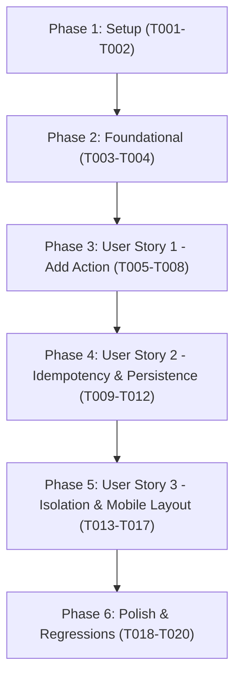

# Tasks: Add Questions to Study List from Bank Soal

**Input**: Design documents from `/specs/005-bank-to-study-list/`
**Prerequisites**: `plan.md`, `spec.md`, `research.md`, `data-model.md`, `contracts/study-list-action.md`, `quickstart.md`
**Tests**: Automated CDP regression test suite included (`tests/test-bank-study-action.mjs`).
**Organization**: Tasks are grouped by user story to enable independent implementation and testing of each story.

---

## Baseline Test Notice & Non-Interference Invariants

> [!NOTE]
> **Baseline Regression Test Resolution**:
> - **Investigation**: Line 66 in `tests/verify-cache-governance.js` previously performed a rigid literal LF (`\n`) string search against `sw.js`, failing in Windows environments where files check out with CRLF (`\r\n`).
> - **Resolution**: `tests/verify-cache-governance.js` was updated to be line-ending-independent by normalizing line endings before checking, without weakening dynamic prefix gating or modifying application code.
> - **Validation**: All 7 regression test suites (`verify-cache-governance.js`, `test-cache-cleanup-scenarios.js`, `test-exam-timer-centering.mjs`, `test-exam-scroll-lock.mjs`, `test-global-swipe-navigation.mjs`, `test-bank-soal-performance.mjs`, and `test-bank-study-action.mjs`) pass sequentially with Exit Code 0.
> - **Invariants Maintained**: Zero modifications to `sw.js`, CBT engine, or swipe implementation. All Feature 005 additions preserved.

---

## Phase 1: Setup (Shared Infrastructure)

**Purpose**: Environment verification and test framework preparation

- [X] T001 Verify active working directory and branch state for Feature 005 in `specs/005-bank-to-study-list/`
- [X] T002 Document baseline regression error analysis (CRLF mismatch in `tests/verify-cache-governance.js` line 66) and enforce non-interference boundaries (no changes to CBT engine, `sw.js` cache governance, or swipe navigation) in `specs/005-bank-to-study-list/research.md`

---

## Phase 2: Foundational (Blocking Prerequisites)

**Purpose**: Core test harness and shared UI layout rules that all user stories depend on

- [X] T003 Prepare test framework harness for Bank Soal Study List action in `tests/test-bank-study-action.mjs` with CDP client setup, static test server, multi-viewport emulations (390×844 and 1440×900), and IndexedDB reader utilities
- [X] T004 [P] Add mobile layout grid reflow rule for 4 action buttons (`38px repeat(3, minmax(0, 1fr))`) and `.zen-study-btn` button styles (normal, active `#0f766e`, tap states) in `ZEN-PAGES.css`

---

## Phase 3: User Story 1 - Add Question to Study List with Immediate Feedback (Priority: P1) 🎯 MVP

**Goal**: Allow candidates to click a `+` button on any question card in Bank Soal to save that question to the Study List, updating the button to `✓`, displaying a confirmation toast, and incrementing the sidebar badge.

**Independent Test**: Navigate to `#bank`, click `+` on an unbookmarked question, assert button becomes `✓` with `.is-active`, confirmation toast is displayed, sidebar Study List badge increments by 1, and the record is persisted in IndexedDB store `studyList` with composite key `${setId}::${q.id}`.

### Tests for User Story 1

- [X] T005 [P] [US1] Create automated test scenario for adding unbookmarked question in `tests/test-bank-study-action.mjs` verifying DOM state transition, toast notification, sidebar badge increment, and IndexedDB `studyList` write

### Implementation for User Story 1

- [X] T006 [US1] Implement `.zen-study-btn` markup rendering in `renderBank()` within `app.js` evaluating `isQuestionInStudy(q)` to render `+` or `✓`, with `data-action="add-bank-study"`, `data-id="${esc(q.id)}"`, `aria-label`, and `title`
- [X] T007 [US1] Implement `case 'add-bank-study':` click handler in `app.js` with async pending lock (`el.dataset.pending = '1'`), record creation via `makeStudyItem(q)`, persistence via `put('studyList', newItem)`, sidebar badge sync via `updateStudyBadge()`, success toast, and in-place DOM updates (`el.textContent = '✓'`, `el.classList.add('is-active')`)
- [X] T008 [US1] Verify User Story 1 automated test passes in `tests/test-bank-study-action.mjs`

**Checkpoint**: User Story 1 is fully functional and testable independently as the minimal viable product (MVP).

---

## Phase 4: User Story 2 - Idempotent Add-Only Behavior & State Persistence (Priority: P2)

**Goal**: Ensure the Study List action button is strictly idempotent and add-only (clicking a question already in Study List NEVER deletes or removes it), and ensure bookmarked status persists across page reloads.

**Independent Test**: Click an already-bookmarked question (`✓`) in Bank Soal, verify it remains in the Study List without deletion or duplicate record creation. Reload the page, navigate to Bank Soal, and verify all previously bookmarked cards immediately display `✓` and `.is-active`.

### Tests for User Story 2

- [X] T009 [P] [US2] Create automated test scenario for idempotent add-only behavior and persistence in `tests/test-bank-study-action.mjs` asserting zero deletions and zero duplicates on subsequent clicks, plus state retention after page reload

### Implementation for User Story 2

- [X] T010 [US2] Add idempotency guard to `case 'add-bank-study':` in `app.js` (`if (isQuestionInStudy(q)) { toast('Soal sudah tersimpan di Study List.', 'info'); return; }`) ensuring clicking already-added questions never calls `del` or removes items from `state.studyList`
- [X] T011 [US2] Verify Study List view synchronization in `app.js` ensuring questions added from Bank Soal render completely with Japanese prompt, options, correct answer, and explanation in `#study` view
- [X] T012 [US2] Verify User Story 2 automated test passes in `tests/test-bank-study-action.mjs`

**Checkpoint**: User Stories 1 and 2 are fully functional and verified.

---

## Phase 5: User Story 3 - Action Isolation, Browsing Invariance & Mobile Layout (Priority: P3)

**Goal**: Ensure clicking the Study List action button does not trigger parent card clicks, detail modals, or checkbox selection, preserves active pagination and search filters without re-render, and fits cleanly across mobile viewports.

**Independent Test**: Navigate to Page 2 of Bank Soal with an active search query, click `+` on a question, verify pagination remains on Page 2, the search query remains active, no modal is opened, and on 390px viewport all 4 action buttons fit with zero horizontal overflow.

### Tests for User Story 3

- [X] T013 [P] [US3] Create automated test scenario for action isolation, pagination/filter invariance, and mobile viewport parity in `tests/test-bank-study-action.mjs`

### Implementation for User Story 3

- [X] T014 [US3] Enforce event isolation and `event.stopPropagation()` on `add-bank-study` in `app.js` guaranteeing parent card checkboxes and detail triggers are not activated
- [X] T015 [US3] Validate in-place DOM update mechanism in `app.js` ensuring active page (`state.bankCurrentPage`), search query, package filter, and window scroll position remain 100% untouched without full `renderBank()` execution
- [X] T016 [US3] Verify mobile responsive layout ergonomics on 390×844 and 360×740 viewports in `ZEN-PAGES.css` ensuring 4 buttons display without line clipping, text wrapping, or horizontal scrollbar overflow
- [X] T017 [US3] Verify User Story 3 automated test passes in `tests/test-bank-study-action.mjs`

**Checkpoint**: All three user stories are complete, isolated, and verified across viewports.

---

## Phase 6: Polish & Cross-Cutting Concerns

**Purpose**: Regression testing across unaffected features, manual validation, and documentation sign-off

- [X] T018 [P] Run cross-feature regression suite (`test-global-swipe-navigation.mjs`, `test-bank-soal-performance.mjs`, `test-exam-scroll-lock.mjs`) ensuring zero regressions in swipe navigation, CBT exam engine, or Bank Soal lazy rendering
- [X] T019 Perform manual end-to-end verification following `specs/005-bank-to-study-list/quickstart.md` on desktop (1440px) and mobile Android (390px) viewports and capture verification screenshots
- [X] T020 Complete feature documentation and update all validation criteria in `specs/005-bank-to-study-list/checklists/requirements.md`

---

## Dependencies & Execution Order

### Phase Dependencies

### User Story Dependencies

- **User Story 1 (P1)**: Starts after Foundational phase (T003, T004). Delivers the primary `+` button, record addition, toast feedback, and badge increment.
- **User Story 2 (P2)**: Builds upon US1 button handler to enforce idempotent add-only behavior (no deletion) and verifies persistence after reload.
- **User Story 3 (P3)**: Validates non-interference guarantees (pagination invariance, filter invariance, event isolation) and mobile responsive layout parity.

### Parallel Opportunities

- **Phase 2**: `T004` (CSS styling in `ZEN-PAGES.css`) can proceed in parallel with `T003` (test harness setup in `tests/test-bank-study-action.mjs`).
- **Phase 3**: `T005` (test scenario authoring) can be written before or alongside `T006` (markup in `app.js`).
- **Phase 4**: `T009` (idempotency test scenario) can run in parallel with `T010` (idempotency guard in `app.js`).
- **Phase 5**: `T013` (isolation test scenario) can run in parallel with `T014`/`T016`.
- **Phase 6**: `T018` (automated regression tests) can run in parallel with documentation updates in `T020`.

---

## Implementation Strategy

### MVP First (User Story 1 Only)
1. Complete Phase 1 (Setup) and Phase 2 (Foundational).
2. Complete Phase 3 (User Story 1: T005–T008).
3. Validate User Story 1 independently in browser: candidates can add questions from Bank Soal to Study List.

### Incremental Delivery
1. Phase 3 (US1): Candidates can add questions with instant visual feedback.
2. Phase 4 (US2): Idempotent add-only safety prevents unintended deletions or duplicate records.
3. Phase 5 (US3): Ergonomic layout on mobile (390px) and zero interference with pagination or filters.
4. Phase 6 (Polish): Full regression verification across all application modules.
