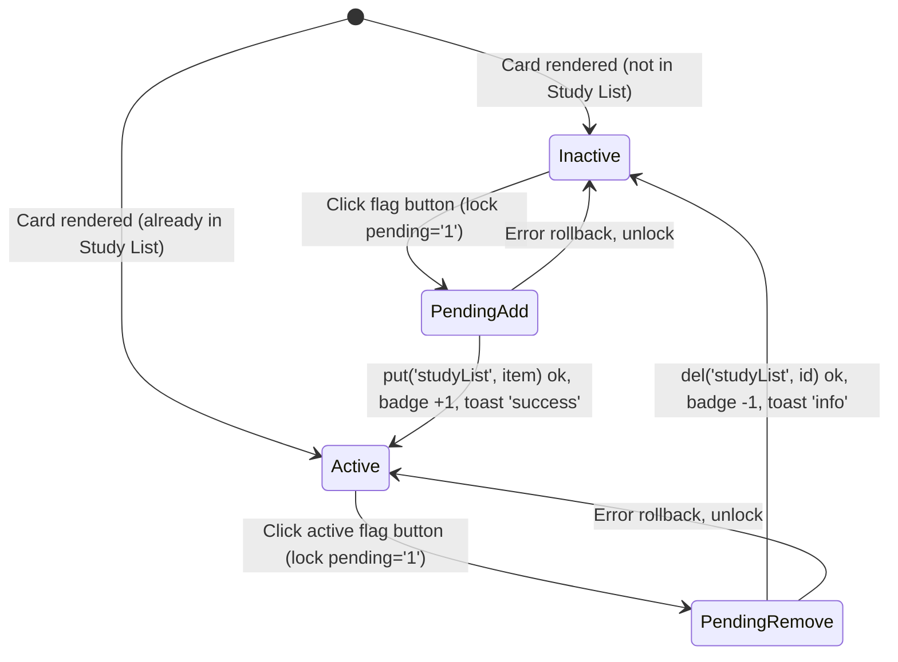
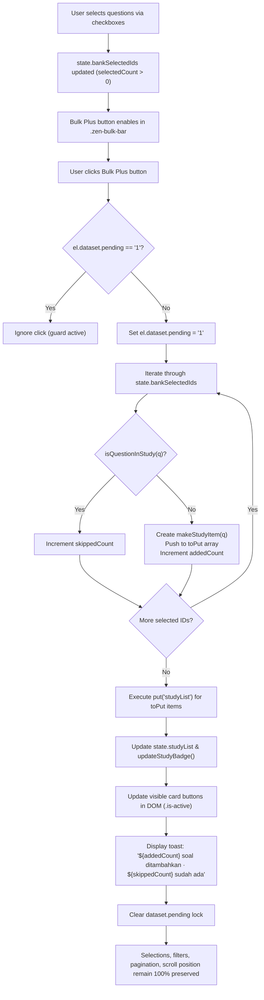

# Data Model: Study List UX Refinement

**Feature**: `specs/006-study-list-ux-refinement`
**Date**: 2026-11-10
**Status**: Completed

---

## 1. Entities & Schemas

### Entity 1: StudyListItem
Represents a question bookmarked by the candidate for targeted revision. Stored in IndexedDB object store `studyList`.

```typescript
interface StudyListItem {
  /** Deterministic composite identifier: `${packageId}::${questionId}` */
  id: string;
  compositeId: string;

  /** Source question package ID (e.g., 'ssw-pm-kunci-ujian-1') */
  packageId: string;
  setId: string;

  /** Human-readable package title */
  setName: string;

  /** Source question ID within the package */
  questionId: string;

  /** Display number of the question */
  questionNumber: number;

  /** Prompt with optional Kanji Furigana annotations (<ruby>) */
  prompt: string;
  questionText: string;

  /** Section instructions */
  instructions?: string;

  /** Array of answer choices */
  options: Array<{
    id: string;
    text: string;
    translation?: string;
    mediaId?: string;
  }>;

  /** Zero-based index of the correct answer */
  correctIndex: number;
  correctAnswer: string;

  /** Explanation and Indonesian notes */
  explanation?: string;
  promptTranslation?: string;

  /** Media metadata if question is illustrated */
  imageMediaId?: string | null;
  questionImage?: string | null;
  imageSize?: 'small' | 'medium' | 'large';
  imageRatio?: 'auto' | '16:9' | '4:3' | '1:1';
  imagePosition?: 'center' | 'left' | 'right';
  media?: any;

  /** ISO timestamp when bookmarked */
  addedAt: string;
}
```

---

### Entity 2: QuestionCardStudyState
Represents the local UI presentation state of an individual question card in Bank Soal.

```typescript
interface QuestionCardStudyState {
  questionId: string;
  compositeId: string;
  inStudy: boolean;
  dataAction: 'toggle-bank-study';
  buttonClass: string;          // 'hd-row-btn zen-study-btn' (+ ' is-active' if inStudy)
  ariaPressed: 'true' | 'false';
  ariaLabel: string;            // 'Hapus dari Study List' | 'Tambahkan ke Study List'
  title: string;                // 'Hapus dari Study List' | 'Tambahkan ke Study List'
  isPending: boolean;           // dataset.pending lock state
}
```

---

### Entity 3: BulkAddResult
Represents the operational outcome of a batch addition from the selection toolbar.

```typescript
interface BulkAddResult {
  totalSelected: number;        // Total IDs in state.bankSelectedIds
  addedCount: number;           // Newly added records stored to IndexedDB
  skippedCount: number;         // Existing records skipped (already in Study List)
  toPut: StudyListItem[];       // Array of items to be inserted
  feedbackToast: string;        // Formatted feedback e.g., "3 soal ditambahkan · 2 sudah ada"
  toastType: 'success' | 'info';
}
```

---

### Entity 4: SelectionToolbarState
Represents the state of controls in `.zen-bulk-bar`.

```typescript
interface SelectionToolbarState {
  selectedCount: number;        // Number of selected question IDs
  allVisibleSelected: boolean;  // True if all questions on active page are selected
  isBulkStudyDisabled: boolean; // True when selectedCount === 0
  isClearDisabled: boolean;     // True when selectedCount === 0
  isDeleteDisabled: boolean;    // True when selectedCount === 0
}
```

---

## 2. State Transition Diagrams

### Individual Flag Two-Way Toggle


### Bulk Add Workflow

