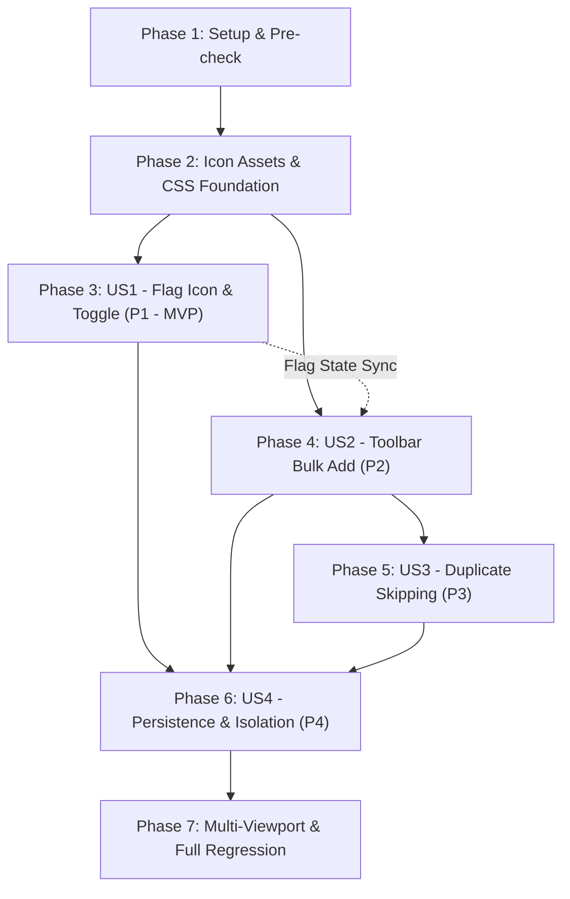

# Tasks: Feature 006 — Study List UX Refinement

**Feature**: `specs/006-study-list-ux-refinement`
**Input**: Design documents from `specs/006-study-list-ux-refinement/` (`spec.md`, `plan.md`, `research.md`, `data-model.md`, `contracts/`, `quickstart.md`)
**Prerequisites**: Active branch `feat/study-list-ux-refinement`, `.specify/feature.json` points to `specs/006-study-list-ux-refinement`
**Tests**: Automated CDP regression test suite in `tests/test-study-list-ux-refinement.mjs`
**Organization**: Tasks are grouped by user story to enable independent implementation and testing of each story.

## Format: `[ID] [P?] [Story] Description`
- **[P]**: Can run in parallel (different files, no blocking dependencies)
- **[Story]**: Which user story this task belongs to (`US1`, `US2`, `US3`, `US4`)
- Exact file paths are included in every task description.

---

## Phase 1: Setup (Harness & Prerequisites)

**Purpose**: Establish regression testing harness and verify baseline invariants before any code changes.

- [x] T001 Verify baseline cache governance and existing test suites pass with exit code 0 (`tests/verify-cache-governance.js`, `tests/test-exam-timer-centering.mjs`)
- [x] T002 [P] Scaffold dedicated regression test suite structure in `tests/test-study-list-ux-refinement.mjs` with CDP static server and device emulation helpers

---

## Phase 2: Foundational (Icon Assets & Shared Styling)

**Purpose**: Core styling and SVG components in `ZEN-PAGES.css` that all user stories depend on.

**CRITICAL**: No user story implementation begins until these foundational styles and glyph definitions are in place.

- [x] T003 Define standalone minimalist outline flag SVG helper and `.zen-flag-icon` styles in `ZEN-PAGES.css` (transparent background in all states, 0 border, 44px touch target with visible 14×14px Lucide-style outline SVG, `fill: none; stroke: currentColor;` for inactive; `fill: currentColor; stroke: currentColor; color: var(--zen-teal, #0f766e);` for `.is-active`; zero circular bubbles, containers, borders, badges, speech bubbles, or bounce/rotation animations)
- [x] T004 [P] Define `.zen-bulk-study-btn` button styles in `ZEN-PAGES.css` matching `.zen-bulk-bar` row button ergonomics with clean inline plus SVG icon (13×13px) and responsive wrap rules
- [x] T005 [P] Add internationalization strings for `studyToggleAction`, `studyAddedToast`, `studyRemovedToast`, and `addSelStudy` in `app.js` dictionary tables (`I18N.id`, `I18N.en`, `I18N.ja`)

**Checkpoint**: Foundation ready — User Story 1 implementation can now begin.

---

## Phase 3: User Story 1 - Minimal Flag Icon & Two-Way Toggle on Individual Cards (Priority: P1) 🎯 MVP

**Goal**: Deliver a clean, minimalist outline flag icon on every question card in Bank Soal that performs a two-way toggle (`toggle-bank-study`): first click adds to Study List, second click removes it, with immediate feedback toasts, sidebar badge sync, and async concurrency protection.

**Independent Test**: Open Bank Soal, click outline flag on question #1 -> turns teal active, toast says `"Soal ditambahkan ke Study List."`, sidebar badge increases (+1). Click question #1 flag again -> reverts to outline, toast says `"Soal dihapus dari Study List."`, sidebar badge decreases (-1).

### Tests for User Story 1
- [x] T006 [P] [US1] Add automated CDP test scenario for minimalist flag icon appearance (verifying SVG outline without bubble containers or animations) in `tests/test-study-list-ux-refinement.mjs`
- [x] T007 [P] [US1] Add automated CDP test scenario for individual flag first-click add and second-click remove with badge assertions in `tests/test-study-list-ux-refinement.mjs`

### Implementation for User Story 1
- [x] T008 [US1] Update `renderBank()` in `app.js` to render `<button type="button" class="hd-row-btn zen-study-btn ${inStudy ? 'is-active' : ''}" data-action="toggle-bank-study" data-id="${esc(q.id)}" title="${inStudy ? 'Hapus dari Study List' : 'Tambahkan ke Study List'}" aria-label="${inStudy ? 'Hapus dari Study List' : 'Tambahkan ke Study List'}" aria-pressed="${inStudy}">` embedding the minimalist `.zen-flag-icon` SVG
- [x] T009 [US1] Implement `case 'toggle-bank-study'` in `handleAction()` in `app.js` with `dataset.pending` async concurrency lock, invoking canonical `toggleStudyItem(q)`, updating button `.is-active` class, title, and aria-pressed attributes in place, and calling `event.stopPropagation()`

**Checkpoint**: User Story 1 (MVP) is fully functional and testable independently.

---

## Phase 4: User Story 2 - Bulk Add Selected Questions via Selection Toolbar (Priority: P2)

**Goal**: Add a minimalist Plus button (`bulk-add-study`) to the Bank Soal selection toolbar (`.zen-bulk-bar`) beside Clear and Delete (outside question cards) that enables when questions are selected and saves all selected questions to the Study List.

**Independent Test**: Select 5 questions using checkboxes in Bank Soal, verify bulk Plus button enables, click it -> all 5 questions saved to Study List, toast displays `"5 soal ditambahkan · 0 sudah ada"`, sidebar badge increases by 5, and all 5 cards reflect active flag states while selections remain intact.

### Tests for User Story 2
- [x] T010 [P] [US2] Add automated CDP test scenario for bulk Plus button placement in `.zen-bulk-bar` (outside cards, beside Clear and Delete) and enabled/disabled state binding in `tests/test-study-list-ux-refinement.mjs`
- [x] T011 [P] [US2] Add automated CDP test scenario for bulk addition of 5 selected questions verifying badge increment and card flag synchronization in `tests/test-study-list-ux-refinement.mjs`

### Implementation for User Story 2
- [x] T012 [US2] Update `.zen-bulk-bar` template in `renderBank()` in `app.js` to insert `<button type="button" class="hd-row-btn zen-bulk-study-btn" data-action="bulk-add-study" ${selectedCount ? '' : 'disabled'} ...>` between Clear Selection and Delete Selected controls
- [x] T013 [US2] Implement `case 'bulk-add-study'` in `handleAction()` in `app.js` with `dataset.pending` lock: iterate `state.bankSelectedIds`, construct `makeStudyItem(q)`, store new items to `studyList` in IndexedDB, update `state.studyList`, update sidebar badge by `addedCount`, and synchronously add `.is-active` to visible question card buttons in DOM

**Checkpoint**: User Stories 1 and 2 work seamlessly together and are independently testable.

---

## Phase 5: User Story 3 - Duplicate Skipping & Safe Partial Bulk Addition (Priority: P3)

**Goal**: Ensure bulk addition skips questions already present in the Study List without deleting or duplicating them, accurately reports added and skipped counts in feedback toast, and increments sidebar badge strictly by the count of newly added items.

**Independent Test**: Add 2 questions to Study List. Select those 2 plus 3 new questions (5 total selected). Click bulk Plus button -> only 3 new questions are added, 2 existing questions remain safely intact with zero duplicate database entries, toast reports `"3 soal ditambahkan · 2 sudah ada"`, and sidebar badge increases by exactly 3.

### Tests for User Story 3
- [x] T014 [P] [US3] Add automated CDP test scenario for mixed bulk addition (selecting pre-existing + new questions) verifying skipping logic, accurate toast format, and zero duplication in `tests/test-study-list-ux-refinement.mjs`
- [x] T015 [P] [US3] Add automated CDP test scenario for bulk addition when ALL selected questions already exist in Study List (`0 soal ditambahkan · N sudah ada`) in `tests/test-study-list-ux-refinement.mjs`

### Implementation for User Story 3
- [x] T016 [US3] Refine `bulk-add-study` handler in `handleAction()` in `app.js` to check `isQuestionInStudy(q)` for each selected ID, increment `skippedCount` for existing items, collect new items in `toPut` array, execute sequential `put('studyList', item)` writes, and pop formatted toast `"${addedCount} soal ditambahkan · ${skippedCount} sudah ada"` (`success` if added > 0 else `info`)

**Checkpoint**: User Stories 1, 2, and 3 provide robust single and batch bookmarking with zero data duplication.

---

## Phase 6: User Story 4 - State Persistence & Non-Interfering Isolation (Priority: P4)

**Goal**: Guarantee that Study List flag states and counts survive full browser reloads, and verify that adding questions (individually or in bulk) does not alter active checkbox selections, search queries, package filters, pagination page, or vertical scroll position, nor interfere with existing Edit, Duplicate, Delete, Clear, or Bulk Delete actions.

**Independent Test**: Set package filter to `ssw-pm-kunci-ujian-1`, navigate to Page 2, select 3 questions, click bulk Plus -> verify active page remains Page 2, filter remains applied, checkboxes remain checked, scroll position is preserved. Reload browser -> verify saved questions retain active flags and sidebar badge displays exact count.

### Tests for User Story 4
- [x] T017 [P] [US4] Add automated CDP test scenario for state persistence across full browser refresh in `tests/test-study-list-ux-refinement.mjs`
- [x] T018 [P] [US4] Add automated CDP test scenario asserting that pagination, search filter, package filter, and checkbox selection states remain intact after bulk addition in `tests/test-study-list-ux-refinement.mjs`
- [x] T019 [P] [US4] Add automated CDP test scenario asserting that existing card Edit, Duplicate, Delete, and toolbar Clear Selection, Delete Selected actions remain 100% operational in `tests/test-study-list-ux-refinement.mjs`

### Implementation for User Story 4
- [x] T020 [US4] Verify and harden in-place DOM updates in `app.js` (`handleAction` for `toggle-bank-study` and `bulk-add-study`) so that DOM state changes do NOT trigger a full `renderBank()` re-render, ensuring scroll position, search input values, and pagination state are 100% preserved
- [x] T021 [US4] Verify that question removal on Study List tab (`removeStudyItem`) correctly synchronizes with Bank Soal when returning to the tab

**Checkpoint**: Full state persistence and non-interfering isolation verified across all user stories.

---

## Phase 7: Polish & Multi-Viewport Layout Verification

**Purpose**: Responsive layout verification, visual inspection across mobile and desktop viewports, and complete regression suite convergence.

- [x] T022 [US4] Add automated CDP multi-viewport assertions in `tests/test-study-list-ux-refinement.mjs` verifying mobile portrait (390×844) and desktop (1440×900) layout parity with zero horizontal scrollbar and no button overlap
- [x] T023 [P] Capture high-resolution verification screenshots for mobile (390px) and desktop (1440px) showing active flag icons and selection toolbar into artifact directory
- [x] T024 Execute full regression test verification sequence:
  1. `node tests/test-study-list-ux-refinement.mjs`
  2. `node tests/verify-cache-governance.js`
  3. `node tests/test-cache-cleanup-scenarios.js`
  4. `node tests/test-exam-timer-centering.mjs`
  5. `node tests/test-exam-scroll-lock.mjs`
  6. `node tests/test-global-swipe-navigation.mjs`
  7. `node tests/test-bank-soal-performance.mjs`
- [x] T025 Confirm all 7 test suites exit with code 0 and reconcile task checkboxes

---

## Dependencies & Execution Order

### Phase Dependencies
- **Phase 1 (Setup)**: No dependencies — starts immediately.
- **Phase 2 (Foundational)**: Depends on Phase 1 — blocks all user stories.
- **Phase 3 (User Story 1 - P1)**: Depends on Phase 2 — core MVP.
- **Phase 4 (User Story 2 - P2)**: Depends on Phase 2; integrates with US1 flag states.
- **Phase 5 (User Story 3 - P3)**: Depends on Phase 4 (builds on bulk addition logic).
- **Phase 6 (User Story 4 - P4)**: Depends on Phases 3, 4, and 5 (verifies persistence & isolation across all stories).
- **Phase 7 (Polish & Verification)**: Depends on completion of all user stories.

### User Story Dependencies

---

## Implementation Strategy

### MVP First (User Story 1)
1. Complete Phase 1 (Setup) and Phase 2 (Foundational CSS & SVG glyph).
2. Complete Phase 3 (User Story 1: Minimal Flag Icon & Two-Way Toggle).
3. **STOP & VALIDATE**: Run `tests/test-study-list-ux-refinement.mjs` for US1 scenarios. MVP is fully functional!

### Incremental Delivery
4. Implement User Story 2 (Toolbar Bulk Add) -> Test independently.
5. Implement User Story 3 (Duplicate Skipping) -> Test independently.
6. Implement User Story 4 (Persistence & Isolation) -> Test independently.
7. Run Phase 7 (Multi-viewport responsive verification and full regression suite).
8. Ensure 100% exit code 0 across all 7 test suites.

---

## Phase 8: Post-Convergence Correction — Individual Plus Icon Replacement

**Purpose**: Replace the individual question card flag SVG with a minimalist plus (+) SVG while strictly preserving two-way toggle behavior, IndexedDB persistence, sidebar badge synchronization, selection toolbar, and all non-interfering invariants.

- [x] T026 [US1] Replace individual question card flag SVG markup in `app.js` (`renderBank()`) and styles in `ZEN-PAGES.css` with a minimalist 14×14px plus (+) SVG (`viewBox="0 0 14 14"`, horizontal: `M2 7h10`, vertical: `M7 2v10`), stroke-based geometry, transparent background in all states, inactive subtle gray (`var(--zen-muted)`), and active restrained teal (`var(--zen-teal)`), maintaining the 44×44px touch target without containers or animations.
- [x] T027 [US1] Update automated CDP regression test suite in `tests/test-study-list-ux-refinement.mjs` to assert the minimalist plus icon geometry, transparent background, 14×14px SVG dimensions, 44px touch target, inactive gray, active teal, two-way toggle invariance, and multi-viewport layout parity.
