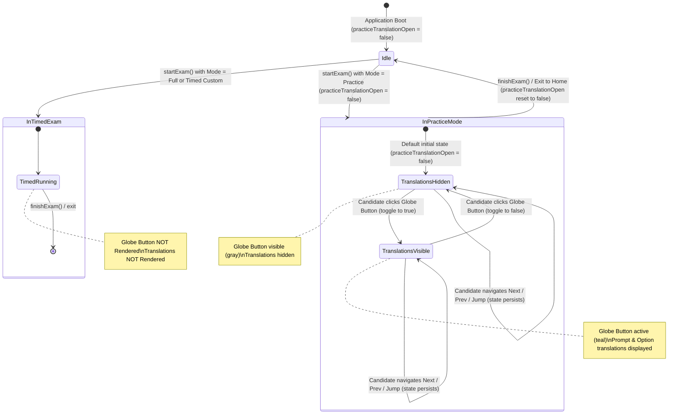
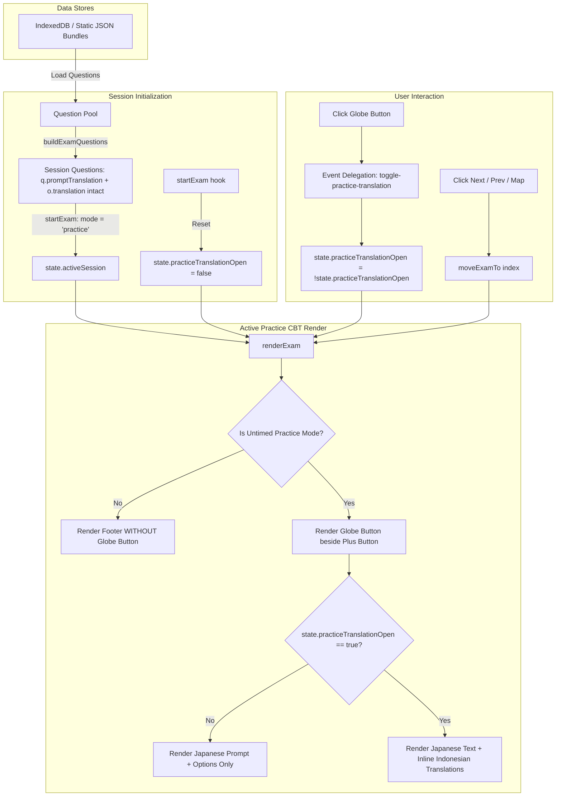

# Data Model & State Transitions: Practice Mode Inline Translations

**Feature**: `specs/007-practice-mode-translations`  
**Date**: 2026-11-11  
**Status**: Completed  

---

## 1. Entities & Data Schema

### Entity 1: PracticeTranslationState (Runtime Session UI State)
Stored on the global `state` object in `app.js` during active sessions.

| Field | Type | Default | Description | Lifecycle |
|---|---|---|---|---|
| `practiceTranslationOpen` | `Boolean` | `false` | Whether inline translations are currently visible in the active Practice session. | Initialized on boot, toggled by candidate click, reset to `false` on `startExam()` and `finishExam()`. |

### Entity 2: Question Entity (`Question`)
Existing question entity stored in IndexedDB (`questions`) and loaded into `state.questions` and `session.questions`.

| Field | Type | Presence | Description |
|---|---|---|---|
| `id` | `String` | Mandatory | Unique question identifier (e.g., `kunci1-q001`). |
| `setId` | `String` | Mandatory | Package identifier (e.g., `ssw-pm-kunci-ujian-1`). |
| `prompt` | `String` | Mandatory | Primary Japanese question prompt (HTML with `<ruby>` Kanji annotations). |
| `promptTranslation` | `String` | Mandatory | Indonesian translation of the question prompt. |
| `options` | `Array<Option>` | Mandatory | Ordered array of answer options. |
| `instructions` | `String` | Mandatory | Japanese instruction line (e.g. `正しいものを一つ選びなさい。`). |
| `correctAnswer` | `String` | Mandatory | Correct option letter (`A`, `B`, `C`, etc.) — *NEVER exposed in translation UI*. |
| `explanation` | `String` | Mandatory | Detailed explanation — *NEVER exposed in translation UI*. |

### Entity 3: Option Entity (`Option`)
Individual choice object inside `Question.options`.

| Field | Type | Presence | Description |
|---|---|---|---|
| `id` | `String` | Mandatory | Option identifier letter (`A`, `B`, `C`). |
| `text` | `String` | Mandatory | Japanese option text (HTML with `<ruby>` Kanji annotations). |
| `translation` | `String` | Mandatory | Indonesian translation of this specific option text. |
| `originalId` | `String` | Optional | Set during option shuffling to preserve original identity. |
| `mediaId` / `optionImage` | `String` | Optional | Optional image attachment path/ID for illustrated options. |

---

## 2. State Machine & Lifecycle Transitions



---

## 3. Data Flow



---

## 4. Option Shuffling Invariance

When `setup.shuffleOptions: true`:
1. Master options array:
   ```javascript
   [
     { id: 'A', text: '安価な原材料', translation: 'Bahan baku yang murah' },
     { id: 'B', text: 'きれいな製造環境', translation: 'Lingkungan produksi yang bersih' },
     { id: 'C', text: '食品の衛生的取扱い', translation: 'Penanganan pangan secara higienis' }
   ]
   ```
2. Shuffled result in `buildExamQuestions()`:
   ```javascript
   [
     { id: 'A', originalId: 'B', text: 'きれいな製造環境', translation: 'Lingkungan produksi yang bersih' },
     { id: 'B', originalId: 'C', text: '食品の衛生的取扱い', translation: 'Penanganan pangan secara higienis' },
     { id: 'C', originalId: 'A', text: '安価な原材料', translation: 'Bahan baku yang murah' }
   ]
   ```
3. In `renderExam()`:
   `o.translation` directly reads `'Lingkungan produksi yang bersih'` for Option A, `'Penanganan pangan secara higienis'` for Option B, and `'Bahan baku yang murah'` for Option C.
4. **Invariant Outcome**: Translations remain 100% paired with their corresponding Japanese text.
