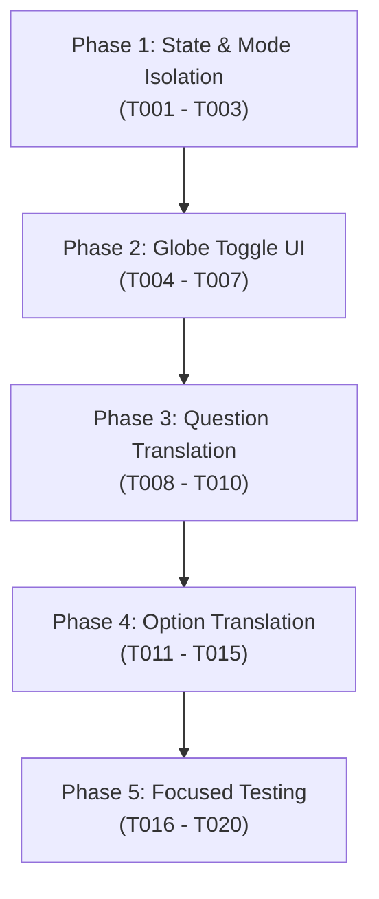

# Tasks: Practice Mode Inline Indonesian Translations

**Input**: Design documents from `specs/007-practice-mode-translations/` (`spec.md`, `plan.md`, `research.md`, `data-model.md`, `contracts/practice-translation-contract.md`, `quickstart.md`)  
**Prerequisites**: `spec.md` (approved), `plan.md` (approved), `research.md` (completed), `data-model.md` (completed), `contracts/` (completed)  
**Tests**: Focused standalone regression suite in `tests/test-practice-mode-translations.mjs`  
**Organization**: Tasks are grouped into 5 dependency-ordered phases covering User Stories US1, US2, and US3.

---

## Format: `- [ ] [TaskID] [P?] [Story?] Description with exact file paths`

- **[P]**: Can run in parallel (different files, no blocking dependencies)
- **[Story]**: Maps task to user story from `spec.md` (`[US1]`, `[US2]`, `[US3]`)
  - **[US1]**: Toggle Practice Mode Inline Translations on Question and Options (Priority: P1, MVP)
  - **[US2]**: Translation State Persistence Across Question Navigation (Priority: P2)
  - **[US3]**: Mode Isolation and Session Lifecycle Reset (Priority: P3)
- Exact file paths included in every task description

---

## Phase 1: State and Practice Mode Isolation

**Purpose**: Establish session-scoped translation state and enforce strict untimed Practice Mode guardrails.

**Story Goal**: Deliver core state management and lifecycle hooks guaranteeing translations only exist in untimed Practice sessions (serves US3 and foundational state for US1/US2).

**Independent Test**: Verify via unit evaluation that `state.practiceTranslationOpen` defaults to `false`, toggles cleanly, resets on `startExam()` / `finishExam()`, and that the `isUntimedPractice` guard evaluates to `false` for Full Mock Test and Timed Custom Exam sessions.

- [X] T001 [US3] Add session-scoped `practiceTranslationOpen: false` property to initial state definition in `app.js`
- [X] T002 [US3] Add state reset logic in `startExam()` and `finishExam()` in `app.js` to strictly reset `state.practiceTranslationOpen` to `false` on session start and exit
- [X] T003 [US3] Implement strict untimed Practice Mode guard condition `const isUntimedPractice = Boolean(s && s.mode === 'practice' && !s.deadline && !s.timed);` in `renderExam()` in `app.js`

**Checkpoint**: Application state supports translation toggle lifecycle with complete isolation from timed exams.

---

## Phase 2: Globe Toggle UI

**Purpose**: Mount the minimalist wireframe globe toggle button into the CBT examination toolbar beside the Study List plus button.

**Story Goal**: Provide candidates with an accessible, minimalist toggle control in untimed Practice Mode (serves US1).

**Independent Test**: Launch an untimed Practice session and verify the globe SVG button renders immediately adjacent to `.study-list-quick-button` within `.exam-bottom-tools`, reflects `aria-expanded` and `title` state, and responds to click events.

- [X] T004 [US1] Add minimalist 16 × 16 px wireframe globe SVG toggle button (`button.exam-tool-button.practice-trans-btn`) adjacent to `.study-list-quick-button` within `.exam-bottom-tools` in `renderExam()` in `app.js`
- [X] T005 [US1] Implement accessible toggle attributes on `.practice-trans-btn` (`data-action="toggle-practice-translation"`, `aria-label="Toggle Terjemahan Indonesia"`, dynamic `title` "Tampilkan Terjemahan"/"Sembunyikan Terjemahan", dynamic `aria-expanded="false"|"true"`, dynamic `aria-pressed="false"|"true"`, and conditional class `is-active`) in `renderExam()` in `app.js`
- [X] T006 [US1] Add click event delegation handler for `data-action="toggle-practice-translation"` in the exam action router in `app.js` to invert `state.practiceTranslationOpen` and trigger re-render via `renderExam()`
- [X] T007 [P] [US1] Add CSS styling rules for `.practice-trans-btn`, `.practice-globe-icon`, and `.practice-trans-btn.is-active` in `ZEN-APP-SHELL.css` (minimum 44 × 44 px touch target, transparent background, inactive icon color `#6c7883`, active state color `#0f766e`, no shadows or decorative cards)

**Checkpoint**: Globe toggle button is interactive, fully accessible, and styled to Zen White design standards.

---

## Phase 3: Question Translation

**Purpose**: Display verified Indonesian prompt translations directly beneath Japanese question text.

**Story Goal**: Allow candidates to read bilingual question prompts when the toggle is enabled (serves US1).

**Independent Test**: Toggle translations ON and verify `
` appears directly beneath `.question-prompt`, displaying `q.promptTranslation` with muted styling, and disappears cleanly when toggled OFF.

- [X] T008 [US1] Render question prompt translation container `
${richHTML(promptTranslation)}
` directly below `.question-prompt` in `renderExam()` in `app.js` when `isUntimedPractice && state.practiceTranslationOpen && promptTranslation` is truthy
- [X] T009 [P] [US1] Add CSS styling for `.practice-question-translation` in `ZEN-APP-SHELL.css` (`margin-top: 8px`, `font-size: 13px`, `line-height: 1.5`, muted color `#5a6672`, transparent background, zero decorative cards or borders)
- [X] T010 [US1] Implement clean fallback handling in `renderExam()` in `app.js` to ensure no empty container or broken DOM gap is rendered when `promptTranslation` is whitespace-only, empty, or missing, or when toggle is OFF

**Checkpoint**: Question prompt translation renders seamlessly below the Japanese prompt when enabled, with zero visual disruption when disabled.

---

## Phase 4: Option Translation

**Purpose**: Display verified Indonesian option translations directly beneath each Japanese answer option.

**Story Goal**: Allow candidates to read individual option translations without altering option layout, bullet formatting, or option shuffling alignment (serves US1 and US2).

**Independent Test**: Toggle translations ON and verify `` appears inside `.answer-content` for each option, displaying `o.translation` with `display: block`, preserving radio indicators, alignment, and selection behavior across shuffled options.

- [X] T011 [US1] Render phrasing element `${richHTML(o.translation)}` directly inside `.answer-content` in `renderExam()` in `app.js` when `isUntimedPractice && state.practiceTranslationOpen && o.translation` is truthy
- [X] T012 [P] [US1] Add CSS styling for `.practice-option-translation` in `ZEN-APP-SHELL.css` (`display: block`, `margin-top: 5px`, `font-size: 12px`, `line-height: 1.4`, muted color `#64748b`, zero bullet points, zero nested cards, preserving parent radio/letter alignment)
- [X] T013 [US1] Audit and verify zero decorative markers (bullets, dots, dashes, extra numbers, or card wrappers) are added to answer choices, strictly preserving existing option selection, hover, and checked styling in `app.js` and `ZEN-APP-SHELL.css`
- [X] T014 [US2] Ensure option-to-translation pairing invariance when `setup.shuffleOptions: true` is active by binding `o.translation` directly from the shuffled option object so each translation strictly matches its displayed Japanese option text in `renderExam()` in `app.js`
- [X] T015 [US2] Verify `state.practiceTranslationOpen` remains unchanged during question navigation via "Next" (`exam-next`), "Previous" (`exam-prev`), and question map jumps (`jump-question`) in `app.js`, preserving translation visibility across the entire session

**Checkpoint**: Full bilingual question and option reading surface complete with perfect option-shuffling invariance and intra-session navigation persistence.

---

## Phase 5: Focused Testing

**Purpose**: Execute comprehensive automated verification of all Feature 007 scenarios via headless Chromium CDP.

**Story Goal**: Empirically prove all 19 functional requirements and 8 success criteria pass without regression (validates US1, US2, and US3).

**Independent Test**: Run `node tests/test-practice-mode-translations.mjs` and confirm all 9 validation scenarios pass with exit code `0`.

- [X] T016 [US1] Create standalone automated test harness `tests/test-practice-mode-translations.mjs` using repository's native headless Chromium CDP runner (`--headless=new`, `--remote-debugging-pipe`) and local static HTTP server
- [ ] T017 [US3] Implement automated test assertions in `tests/test-practice-mode-translations.mjs` for practice-only globe button presence, initial default OFF state (`practiceTranslationOpen === false`), and strict absence in Full Mock Test and Timed Custom Exam sessions
- [ ] T018 [US1] Implement automated test assertions in `tests/test-practice-mode-translations.mjs` for toggle ON/OFF DOM rendering, verified prompt and option translation text display, and clean removal on toggle OFF
- [ ] T019 [US2] Implement automated test assertions in `tests/test-practice-mode-translations.mjs` for navigation persistence across Next, Prev, and question map jumps, and option shuffling invariance (`shuffleOptions: true`)
- [ ] T020 [US1] Implement automated test assertions in `tests/test-practice-mode-translations.mjs` for academic integrity (0% correct answer key or explanation leakage), session exit reset, and multi-viewport touch ergonomics (390px mobile and 1440px desktop minimum 44 × 44 px target clearance)

**Checkpoint**: All 20 tasks verified through empirical automated testing with 100% test scenario pass rate.

---

## Dependencies & Execution Order

### Phase Dependencies

- **Phase 1 (State & Mode Isolation)**: Foundational prerequisite. Defines state properties and mode boundary guards. Blocks Phase 2, 3, 4.
- **Phase 2 (Globe Toggle UI)**: Mounts the interactive trigger into `.exam-bottom-tools`. Enables interactive verification for Phase 3 and 4.
- **Phase 3 (Question Translation)**: Implements prompt translation rendering and styling.
- **Phase 4 (Option Translation)**: Implements option translation rendering, block display phrasing element, and shuffling invariance.
- **Phase 5 (Focused Testing)**: End-to-end regression validation covering all 3 user stories.

### User Story Dependencies

- **User Story 3 (Mode Isolation & Reset)**: Implemented in Phase 1 (T001–T003) and validated in Phase 5 (T017). Foundational for untimed practice safety.
- **User Story 1 (Toggle Inline Translations - MVP)**: Implemented across Phase 2 (T004–T007), Phase 3 (T008–T010), and Phase 4 (T011–T013). Validated in Phase 5 (T016, T018, T020).
- **User Story 2 (Navigation Persistence & Shuffle Invariance)**: Implemented in Phase 4 (T014–T015) and validated in Phase 5 (T019). Builds upon US1 rendering pipeline.

---

## Parallel Execution Opportunities

- **T006 (app.js) & T007 (ZEN-APP-SHELL.css)**: Event handler implementation and CSS styling for the globe button touch target can be developed concurrently once T004/T005 markup structure is defined.
- **T008 (app.js) & T009 (ZEN-APP-SHELL.css)**: Prompt translation rendering in `app.js` and prompt translation CSS styling in `ZEN-APP-SHELL.css` can be edited in parallel.
- **T011 (app.js) & T012 (ZEN-APP-SHELL.css)**: Option translation markup in `app.js` and block display styling in `ZEN-APP-SHELL.css` can be edited in parallel.
- **T016 (test harness scaffold)**: The automated test harness file `tests/test-practice-mode-translations.mjs` can be scaffolded in parallel with Phase 4 implementation.

---

## Implementation Strategy

### MVP First (Phases 1–3)

1. Complete Phase 1: State definition and Practice Mode isolation guards.
2. Complete Phase 2: Globe toggle SVG button and click router handler.
3. Complete Phase 3: Question prompt translation rendering.
4. **Validation Checkpoint**: Verify candidates can toggle prompt translations ON and OFF in Practice Mode with zero leakage to Full Mock Test.

### Incremental Delivery (Phases 4–5)

1. Complete Phase 4: Option translation rendering, inline phrasing element structure, and shuffling invariance.
2. Complete Phase 5: Build and execute the full automated CDP test suite (`tests/test-practice-mode-translations.mjs`).
3. **Delivery Gate**: Verify 0% answer/explanation leakage, 44 × 44 px touch clearance on 390px mobile and 1440px desktop, and clean session reset on exit.

---

## Notes

- All tasks strictly adhere to the checklist format: `- [ ] [TaskID] [P?] [Story?] Description with exact file paths`.
- No runtime external packages, CDN links, or translation APIs may be introduced.
- Existing answer option appearance (radio circles, option letters, selection highlights) must remain completely untouched.
- Question prompt translations reuse `q.promptTranslation`; option translations reuse `o.translation`.
