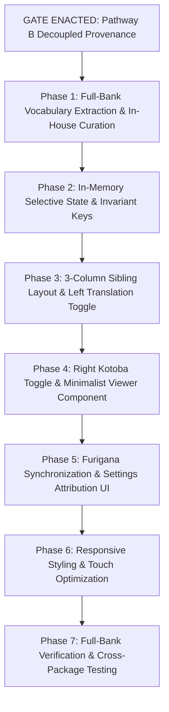

# Implementation Plan: Practice Mode — Selective Translation & Kotoba Reveal (Pathway B Provenance Architecture)

**Feature Branch**: `feat/practice-selective-translation-kotoba`  
**Feature Directory**: `specs/008-practice-selective-translation-kotoba/`  
**Date**: 2026-11-12 (Updated: Pathway B Decoupled Provenance Architecture)  
**Status**: Ready for Implementation (Licensing Gate Enacted)  

---

## 1. Technical Context & Scope Mandate

Feature 008 provides granular, line-by-line Sentence Translation and technical vocabulary (Kotoba) reveal controls for untimed CBT Practice Mode across **ALL 1,006 unique questions and 3,110 unique options across all 27 packages in the entire SSW PM question bank**.

- **Full Bank Scope & Reconciliation**: All 7 question bundle files contain 1,086 raw question records: `questions.json` (80), `ssw-pm-all-kunci-ujian-3-to-13.json` (440), `ssw-pm-bonus-soal-1-to-10-bundle.json` (354), `ssw-pm-kunci-ujian-1.json` (40), `ssw-pm-kunci-ujian-2.json` (40), `ssw-pm-special-lab-bundle.json` (92), and `ssw-pm-tipe2-nguyen1.json` (40). Deduplicating cross-file duplicates (the exact 80 duplicate questions in `questions.json` mirroring `kunci-ujian-1` and `kunci-ujian-2`) yields exactly **1,006 net unique questions** and **3,110 net unique options** (all verified unique per question).
- **4-Tier Coverage Taxonomy**:
  1. *Extraction Coverage*: 100% of 1,006 unique questions and 3,110 options scanned.
  2. *Vocabulary Coverage*: Relevant terms mapped to central dictionary registry.
  3. *Verified Coverage*: Terms validated against JMdict/ruby with in-house curated Indonesian definitions.
  4. *Unresolved Tracking*: Unverified terms marked `status: 'unresolved'` and excluded from UI rendering.
- **Data Architecture**: Shared Deduplicated Vocabulary Store (`sharedKotobaDictionary.json`) referenced via `kotobaIds: string[]`.
- **Licensing Decision Enacted**: **Pathway B with Decoupled Provenance Architecture**.
- **Furigana Engine**: Zero-state reuse of existing `state.examPrefs.showFurigana` and CSS gating rule `body.hide-furigana ruby rt { display: none !important; }`.
- **Mode Isolation**: Untimed Practice Mode only (`s.mode === 'practice' && !s.deadline && !s.timed`). Full Mock Test and Timed Exams remain 100% isolated.

---

## 2. Gate Decision Enacted: Pathway B with Provenance Separation

> [!IMPORTANT]
> **EXECUTIVE LICENSING DECISION (PATHWAY B)**:  
> 1. **Zero JIDict Bundling**: The project strictly rejects bundling or relying upon Philia Space JIDict (CC BY-NC 4.0) data to prevent commercial and subscription model conflicts.
> 2. **JMdict (EDRDG) Integration**: Uses JMdict strictly for base Japanese lemmas and readings under **Creative Commons Attribution-ShareAlike 4.0 International (CC BY-SA 4.0)**.
> 3. **Decoupled Field Provenance**: Field-by-field provenance tracking cleanly separates upstream lemma data from in-house Indonesian pedagogical definitions.
> 4. **Original In-House Curation**: All Indonesian definitions are authored and contextually disambiguated specifically for the SSW Food Manufacturing domain (HACCP, 5S, machinery, hygiene) based on official exam textbooks.
> 5. **ShareAlike Release of Dictionary Asset**: In compliance with CC BY-SA 4.0, `data/sharedKotobaDictionary.json` is released as an open adapted dataset under CC BY-SA 4.0.
> 6. **Commercial Software Protection (Mere Aggregation)**: The CBT simulator engine (`app.js`), styling (`ZEN-APP-SHELL.css`), subscription access control, and question bank JSON remain proprietary. CC BY-SA applies solely to the adapted dictionary asset.
> 7. **Upstream Snapshot & Update Maintenance**: Upstream JMdict snapshot date, commit, and license details are tracked in `_meta`. Errata and corrections are maintained via semantic versioning.
> 8. **UI Attribution Delivery**: Clear attribution to EDRDG and link to CC BY-SA 4.0 are displayed in the Exam Settings Modal (`⚙`) and About/Legal view.
> 9. **Ruby Cross-Check**: Authentic `<ruby><rt>` markup in the 1,006 questions and 3,110 options provides empirical validation for kanji-furigana pairs.
> 10. **No False Claims**: The project documents all licensing obligations transparently and never claims to be "100% copyright-clear" without qualification.

---

## 3. Implementation Phases

### Phase 1: Full-Bank Vocabulary Extraction & In-House Curation (Pathway B)
- **Extraction**: Scan all 1,006 questions and 3,110 options across all 27 packages for technical Japanese vocabulary.
- **Ruby Cross-Check**: Extract kanji-reading pairs from existing exam `<ruby><rt>` markup and cross-verify with JMdict (CC BY-SA 4.0) base entries.
- **Deduplication**: Normalize unique terms by lemma + reading to construct `sharedKotobaDictionary.json`.
- **In-House Indonesian Curation**: Author concise, contextually disambiguated Indonesian definitions for the SSW Food Manufacturing domain (e.g. `仕込み`, `揚げる`, `盛付け`, `交差汚染`).
- **Audit Ledger & Provenance**: Populate granular `provenance` metadata for each entry and log any unverified terms as `status: 'unresolved'`.
- **Machine Translation Prohibition**: Machine translation results are strictly excluded from verified status.
- **Dataset License**: Release `sharedKotobaDictionary.json` with `_meta` tracking JMdict snapshot date, version, CC BY-SA 4.0 license, and attribution URL.

### Phase 2: In-Memory Selective State & Composite Option Keys
- Initialize `s.selectiveState` during `startExam()` for practice sessions.
- Cleanly reset `s.selectiveState` in `finishExam()`.
- Implement composite option key `getOptionKey(qId, opt)` returning `${qId}::${opt.originalId || opt.id}` to guarantee absolute state immunity against option shuffling (`setup.shuffleOptions`), strictly prohibiting reliance on visual letter positions A/B/C/D.
- Implement sparse override resolution logic for Sentence Translations and Kotoba lists.

### Phase 3: 3-Column Sibling Layout & Left Translation Toggle
- Wrap prompt in `.practice-prompt-row` (`[Button: Trans] [Center Prompt] [Button: Kotoba]`).
- Wrap each option in `.practice-option-row` (`[Button: Trans] [Radio Choice] [Button: Kotoba]`).
- Mount `.practice-ctrl-trans` with `data-action="toggle-selective-trans"`.
- Implement central click router handler for `toggle-selective-trans`.
- Verify that clicking the left button never invokes `setAnswer` or alters radio selection.

### Phase 4: Right Kotoba Toggle & Minimalist Viewer Component
- Mount `.practice-ctrl-kotoba` with `data-action="toggle-selective-kotoba"`.
- Implement `renderKotobaList(items)` returning minimal vertical items with `<ruby><rt>` markup.
- Implement central click router handler for `toggle-selective-kotoba`.
- Verify that clicking the right button never invokes `setAnswer`.

### Phase 5: Furigana Synchronization & Settings Attribution UI
- Confirm that when the existing toolbar `F` button is toggled, `document.body` toggles `.hide-furigana`.
- Verify that `body.hide-furigana ruby rt { display: none !important; }` immediately hides readings on all open Kotoba lists without closing panels or re-rendering DOM.
- Verify that toggling F back ON reveals readings above kanji.
- Mount EDRDG attribution block in the Exam Settings Modal (`⚙`) under "Informasi Lisensi & Atribusi Kosakata" with active links to EDRDG and CC BY-SA 4.0.

### Phase 6: Responsive Styling & Touch Optimization
- Add grid styling in `ZEN-APP-SHELL.css`: `grid-template-columns: 44px minmax(0, 1fr) 44px`.
- Wrap all hover states in `@media (hover: hover) and (pointer: fine)` to eliminate sticky hover on Android.
- Configure touch feedback via `:active`.
- Ensure touch target minimum 44 × 44 px for both buttons.

### Phase 7: Polish, Legal Attribution & Focused Verification
- Execute Feature 008 Focused Verification Suite Only in `tests/test-practice-selective-kotoba.mjs`, strictly excluding unrelated regression suites (timer, cache, PWA, swipe).
- Test across multiple diverse packages: Official Exam 1, Official Exam 7, Bonus Soal 3, Special Lab, and Tipe 2.
- Verify click independence, shuffle invariance via composite key, furigana synchronization via toolbar F, attribution display in Settings `⚙`, and mode isolation across the entire 1,006 unique question bank.
- Execute Feature 008 acceptance criteria verification only across the 8 targeted scenarios in `quickstart.md`.

---

## 4. File Modification Matrix

| File | Change Scope |
| :--- | :--- |
| `data/sharedKotobaDictionary.json` | New shared deduplicated vocabulary registry containing verified food manufacturing terms under CC BY-SA 4.0. |
| `app.js` | Session state initialization (`selectiveState`), invariant option keying (`getOptionKey`), 3-column row markup rendering, click router actions (`toggle-selective-trans`, `toggle-selective-kotoba`), and Exam Settings attribution section. |
| `ZEN-APP-SHELL.css` | 3-column grid layouts (`.practice-prompt-row`, `.practice-option-row`), control button styles (`.practice-row-ctrl`), touch feedback, and Kotoba list formatting. |
| `tests/test-practice-selective-kotoba.mjs` | Automated verification script covering click isolation, furigana sync, shuffle invariance, and full-bank coverage. |
| `specs/008-practice-selective-translation-kotoba/dictionary-changelog.md` | Tracking version increments, JMdict snapshot updates, and vocabulary errata. |
