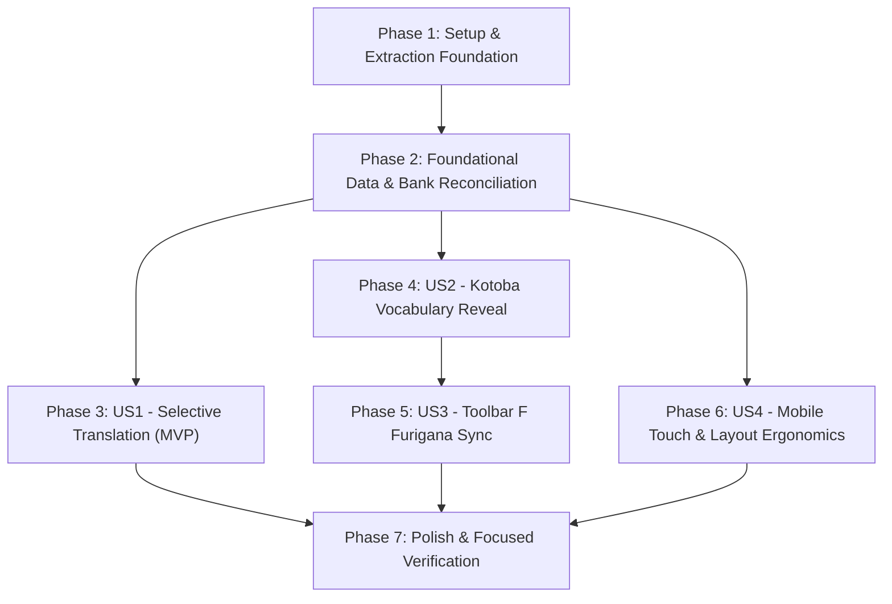

# Tasks: Practice Mode — Selective Translation & Kotoba Reveal (Pathway B Provenance Architecture)

**Input**: Design documents from `specs/008-practice-selective-translation-kotoba/` (`spec.md`, `plan.md`, `data-model.md`, `research.md`, `contracts/selective-kotoba-contract.md`, `quickstart.md`, `checklists/requirements.md`)  
**Prerequisites**: `spec.md`, `plan.md`, `data-model.md`, `research.md`, `contracts/selective-kotoba-contract.md`, `.specify/memory/constitution.md`  
**Target Branch**: `feat/practice-selective-translation-kotoba`  
**Scope**: Full Bank Coverage — All 1,006 unique questions and 3,110 unique options across all 27 packages  

## Format: `[ID] [P?] [Story] Description with exact file path`

- **[P]**: Can run in parallel (different files, no dependencies)
- **[Story]**: User story label (`[US1]`, `[US2]`, `[US3]`, `[US4]`)
- Every task includes an exact file path

---

## Phase 1: Setup (Shared Infrastructure & Data Foundations)

**Purpose**: Establish verified lexicographical sources, snapshot tracking, and extraction tooling under Pathway B.

- [X] T001 Verify upstream JMdict New Generation snapshot (`JMdict_e_NG.gz`, DTD Rev 1.10, XML `created="2026-11-12"`, SHA-256 `60cf4c4c...`, git commit N/A), and CC BY-SA 4.0 license metadata in `specs/008-practice-selective-translation-kotoba/research.md`
- [X] T002 [P] Create full-bank offline extraction script in `scratch/extract-fullbank-vocab.mjs` targeting all 1,006 unique questions and 3,110 unique options across all 27 packages to extract kanji-furigana pairs from `<ruby><rt>` markup
- [X] T003 [P] Initialize vocabulary audit ledger and update log in `specs/008-practice-selective-translation-kotoba/dictionary-changelog.md` to track verified entries, errata, and unresolved terms

---

## Phase 2: Foundational (Blocking Prerequisites & Bank Reconciliation)

**Purpose**: Reconcile question bank records, generate the shared deduplicated dictionary, in-memory selective state, and composite invariant option keying before any UI implementation.

> [!CRITICAL]
> **BLOCKING PREREQUISITE**: Phase 2 must be complete before User Story UI implementation can begin. No JIDict CC BY-NC 4.0 data may be ingested. All Indonesian definitions must be authored in-house under CC BY-SA 4.0.

- [X] T004 Execute full-bank vocabulary extraction script `scratch/extract-fullbank-vocab.mjs` across all 7 bundle files (`questions.json`, `ssw-pm-kunci-ujian-1.json`, `ssw-pm-kunci-ujian-2.json`, `ssw-pm-all-kunci-ujian-3-to-13.json`, `ssw-pm-bonus-soal-1-to-10-bundle.json`, `ssw-pm-tipe2-nguyen1.json`, `ssw-pm-special-lab-bundle.json`):
  - Log raw record counts per file (80 + 40 + 40 + 440 + 354 + 40 + 92 = 1,086 raw records).
  - Identify cross-file duplicate question IDs (verifying the exact 80 duplicates between `questions.json` and `kunci-ujian-1`/`kunci-ujian-2`).
  - Detect and assert content identity across duplicates; designate package-specific bundles (`kunci-ujian-1`, `kunci-ujian-2`) as canonical sources if conflicts arise.
  - Isolate exactly 1,006 unique questions and exactly 3,110 unique options without double-counting.
  - Report separate metrics for raw records (1,086) vs unique questions (1,006) and unique options (3,110).
- [X] T005 Cross-reference extracted vocabulary with JMdict base forms (CC BY-SA 4.0), deduplicate by lemma + reading, and generate dictionary skeleton in `data/sharedKotobaDictionary.json`
- [X] T006 Curate in-house Indonesian definitions contextually disambiguated for food manufacturing (HACCP, 5S, machinery, hygiene) in `data/sharedKotobaDictionary.json` and enforce the 4-tier coverage taxonomy:
  - 1. Extraction coverage: 100% of 1,006 unique questions and 3,110 options scanned.
  - 2. Vocabulary coverage: technical terms mapped to dictionary entries.
  - 3. Verified coverage: terms whose lemma/reading matches JMdict/ruby and whose Indonesian definition is verified in-house.
  - 4. Unresolved tracking: terms lacking high confidence marked `status: 'unresolved'` and excluded from UI rendering; strictly prohibit speculative guessing or treating machine translation as verified.
- [X] T007 [P] Populate dataset metadata in `data/sharedKotobaDictionary.json` under `_meta`: `"datasetVersion": "1.0.0"`, `"datasetLicense": "CC BY-SA 4.0"`, `"upstreamAttribution": { "source": "JMdict by EDRDG", "sourceUrl": "https://www.edrdg.org/edrdg/licence.html" }`, and commercial decoupling notice
- [X] T008 Map stable question IDs and option IDs across all 27 packages to verified term references via sidecar mapping file `data/kotobaMapping.json`, validating option ID presence (100% across all 3,110 options) and per-question option ID uniqueness
- [X] T009 Initialize in-memory selective state `s.selectiveState = { questions: {} }` during `startExam()` and reset in `finishExam()` in `app.js` with non-enumerable descriptor, lazy sparse allocation (`getSelectiveQuestionState`, `getSelectiveOptionState`), and clean storage isolation
- [X] T010 Implement composite stable option key helper `getOptionKey(qId, opt)` in `app.js` returning `${qId}::${opt.originalId || opt.id}` to guarantee absolute state immunity against option shuffling in `buildExamQuestions(setup)` (where `opt.id` becomes 'A'/'B'/'C' but `opt.originalId` preserves the stable ID); strictly prohibit reliance on visual letter positions A/B/C/D

**Checkpoint**: Question bank is reconciled (1,006 unique questions / 3,110 unique options), shared dictionary is compiled, and composite in-memory state architecture is ready. User story UI implementation can begin.

---

## Phase 3: User Story 1 - Full-Bank Selective Sentence Translation (Priority: P1) 🎯 MVP

**Goal**: Enable candidates practicing any of the 1,006 unique questions across all 27 packages to toggle Indonesian sentence translations independently for each question and option in untimed Practice Mode without altering radio selection.

**Independent Test**: Launch untimed Practice session, click left translation button on prompt and individual options; verified Indonesian translation reveals directly beneath the Japanese text; answer radio is NOT selected; state persists across navigation.

### Tests for User Story 1
- [X] T011 [P] [US1] Create automated contract & state test in `tests/test-practice-selective-kotoba.mjs` verifying composite key `${qId}::${opt.originalId || opt.id}` stability before and after `buildExamQuestions(setup)` with `setup.shuffleOptions: true`, left button click isolation, radio non-selection, and untimed practice mode isolation

### Implementation for User Story 1
- [X] T012 [US1] Implement 3-column row markup container `.practice-prompt-row` and `.practice-option-row` with left button `.practice-ctrl-trans` (`data-action="toggle-selective-trans"`) and composite option key `data-opt-key="${esc(getOptionKey(q.id, o))}"` for untimed Practice Mode in `app.js`
- [X] T013 [US1] Implement `toggleSelectiveTrans(s, qId, optKey)` state handler and click router action `toggle-selective-trans` in `app.js`
- [X] T014 [US1] Implement global toolbar globe button interaction logic in `app.js` ensuring master toggle operates cleanly without conflicting with row-level translation overrides

**Checkpoint**: User Story 1 (Selective Translation) is fully functional and testable independently across all 1,006 unique questions.

---

## Phase 4: User Story 2 - Domain-Disambiguated Kotoba Vocabulary Reveal (Priority: P2)

**Goal**: Allow candidates to open technical vocabulary lists (Kotoba) on any question or option to view food manufacturing terminology with in-house curated Indonesian definitions without selecting radio answers.

**Independent Test**: Click right Kotoba button on prompt or option; verified Kotoba entries reveal with base kanji and Indonesian definition; unverified entries are omitted; clicking right button does NOT select answer radio.

### Tests for User Story 2
- [X] T015 [P] [US2] Add Kotoba viewer unit test in `tests/test-practice-selective-kotoba.mjs` verifying vocabulary resolution from `data/sharedKotobaDictionary.json`, unverified term filtering, and click isolation

### Implementation for User Story 2
- [X] T016 [US2] Mount right button `.practice-ctrl-kotoba` (`data-action="toggle-selective-kotoba"`) and composite option key `data-opt-key="${esc(getOptionKey(q.id, o))}"` in `.practice-prompt-row` and `.practice-option-row` in `app.js`
- [X] T017 [US2] Implement `renderKotobaList(items)` component in `app.js` generating minimal vertical items with `<ruby class="kotoba-ruby">${kanji}<rt>${furigana}</rt></ruby>`, separator `—`, and Indonesian definition (`arti`), filtering out unverified terms
- [X] T018 [US2] Implement `toggleSelectiveKotoba(s, qId, optKey)` state handler and click router action `toggle-selective-kotoba` in `app.js`

**Checkpoint**: User Story 2 (Kotoba Reveal) is fully functional and integrated cleanly into the 3-column layout.

---

## Phase 5: User Story 3 - Synchronized Furigana Inspection via Toolbar F (Priority: P3)

**Goal**: Kotoba terms display base kanji without furigana by default, and immediately show or hide furigana readings whenever the existing toolbar F button (`.furigana-quick-button`) is toggled, without closing open Kotoba lists and without re-rendering the exam DOM.

**Independent Test**: Open Kotoba list while toolbar F is OFF (base kanji displays without readings); click toolbar F button (furigana readings appear above kanji instantly); click F button again (readings disappear); Kotoba list remains open throughout.

### Tests for User Story 3
- [X] T019 [P] [US3] Add Furigana synchronization test in `tests/test-practice-selective-kotoba.mjs` asserting `<rt>` visibility toggling via `body.hide-furigana` without DOM re-render or panel dismissal

### Implementation for User Story 3
- [X] T020 [US3] Wire `renderKotobaList` in `app.js` to ensure kanji and readings use native `<ruby class="kotoba-ruby">${kanji}<rt>${furigana}</rt></ruby>` markup compatible with existing `body.hide-furigana`
- [X] T021 [US3] Add CSS rules in `ZEN-APP-SHELL.css` enforcing `body.hide-furigana .kotoba-ruby rt { display: none !important; }` and zero layout shifting when furigana toggles

**Checkpoint**: User Story 3 (Furigana Synchronization) operates seamlessly with zero new state and zero DOM churn.

---

## Phase 6: User Story 4 - Accidental-Click-Free Mobile Touchscreen & Desktop Ergonomics (Priority: P4)

**Goal**: Provide an ergonomic, responsive 3-column layout where control buttons have minimum 44 × 44 px touch targets, are widely separated by the answer choice, and eliminate sticky hover artifacts on Android touchscreens.

**Independent Test**: Inspect on Android viewport (390px) and desktop (1440px); left and right buttons separated by >= 200px gap; tapping control button does not activate answer radio; touching on mobile leaves no persistent hover styling.

### Implementation for User Story 4
- [X] T022 [P] [US4] Implement responsive grid layout for `.practice-prompt-row` and `.practice-option-row` (`grid-template-columns: 44px minmax(0, 1fr) 44px`, `gap: 10px`) in `ZEN-APP-SHELL.css`
- [X] T023 [P] [US4] Style `.practice-row-ctrl` in `ZEN-APP-SHELL.css` with transparent neutral default, green active accent (`#a9d16b`), and desktop-only hover via `@media (hover: hover) and (pointer: fine)`
- [X] T024 [P] [US4] Implement touch feedback `:active` states in `ZEN-APP-SHELL.css` ensuring immediate response without sticky hover on mobile touchscreens
- [X] T025 [US4] Enforce vertical content stacking order in `ZEN-APP-SHELL.css`: Japanese base text → Indonesian translation → Kotoba list

**Checkpoint**: All 4 user stories are fully responsive, touch-optimized, and free of accidental radio selection.

---

## Phase 7: Polish, Legal Attribution & Focused Verification

**Purpose**: Fulfill CC BY-SA 4.0 legal obligations, update offline caching, and execute Feature 008 focused verification.

- [X] T026 [P] Mount EDRDG attribution section in the Exam Settings Modal (`⚙`) in `app.js` and `index.html` with explicit links to EDRDG and CC BY-SA 4.0
- [X] T027 [P] Add `data/sharedKotobaDictionary.json` to the Service Worker precache list in `sw.js` and increment shell cache version
- [X] T028 Run Feature 008 Focused Verification Suite Only via `node tests/test-practice-selective-kotoba.mjs`, verifying 1,006 unique questions, 3,110 options, composite key stability, click isolation, Furigana toolbar F sync, shuffle invariance, and untimed practice mode isolation; strictly exclude unrelated regression suites (timer, cache, PWA, swipe)
- [X] T029 Execute Feature 008 Acceptance Criteria Verification Only across the 8 targeted scenarios in `specs/008-practice-selective-translation-kotoba/quickstart.md` (mode isolation, click independence, toolbar F sync, global globe interaction, shuffle invariance, Android touch feedback, cross-package coverage, and settings attribution)

---

## Dependencies & Execution Order

### Phase Dependencies
- **Phase 1 (Setup)**: Can start immediately. No dependencies.
- **Phase 2 (Foundational Data & Bank Reconciliation)**: Depends on Phase 1. **BLOCKS all User Stories**.
- **Phase 3 (User Story 1 - Translation)**: Depends on Phase 2. Delivers MVP.
- **Phase 4 (User Story 2 - Kotoba Reveal)**: Depends on Phase 2 and integrates with 3-column layout from Phase 3.
- **Phase 5 (User Story 3 - Furigana Sync)**: Depends on Phase 4 Kotoba markup.
- **Phase 6 (User Story 4 - Touch & Layout)**: Can proceed in parallel with Phase 3–5 styling.
- **Phase 7 (Polish & Focused Verification)**: Depends on completion of all User Stories.

### User Story Dependencies

---

## Parallel Execution Opportunities

- **Phase 1**: T002 (extraction script) and T003 (changelog setup) can execute in parallel.
- **Phase 2**: T007 (metadata) can execute in parallel with T006 (curation).
- **Phase 3**: T011 (test writing) can execute in parallel with T012 (markup).
- **Phase 4**: T015 (test writing) can execute in parallel with T016 (button mounting).
- **Phase 5**: T019 (test writing) can execute in parallel with T020 (markup check).
- **Phase 6**: T022, T023, and T024 (CSS rules) can execute in parallel.
- **Phase 7**: T026 (attribution modal) and T027 (service worker) can execute in parallel.

---

## Implementation Strategy

### MVP Scope (Phase 1 + Phase 2 + Phase 3: User Story 1)
1. Complete Phase 1 (Setup & extraction tools).
2. Complete Phase 2 (Bank reconciliation, foundational data model & composite option keys).
3. Complete Phase 3 (User Story 1: Selective Sentence Translation).
4. **VALIDATE MVP**: Verify selective sentence translation operates cleanly across all 1,006 unique questions and 3,110 unique options with zero radio selection bugs, shuffle invariance via `${qId}::${opt.originalId || opt.id}`, and complete mode isolation.

### Incremental Full Bank Delivery
1. Foundation + US1 (Sentence Translation MVP).
2. US2 (Kotoba Reveal with verified food manufacturing definitions and transparent unresolved tracking).
3. US3 (Toolbar F Furigana synchronization).
4. US4 (Responsive touch ergonomics & anti-sticky hover).
5. Phase 7 (Legal attribution in Settings `⚙`, Service Worker caching, and Feature 008 focused verification).
