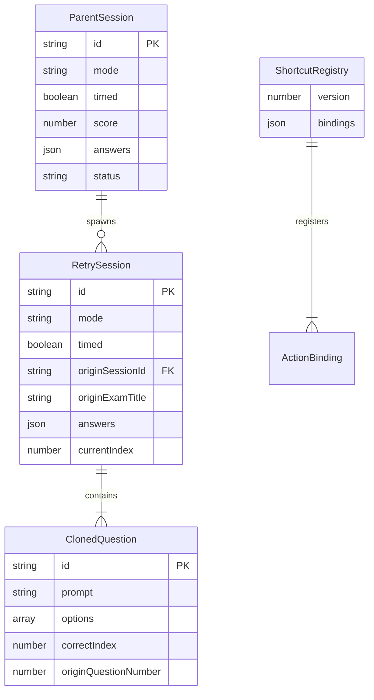
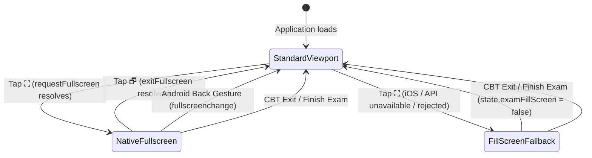

# Data Model: Practice Review Retry, Keyboard Enhancements & Android Fullscreen Fix

**Feature**: `010-practice-review-retry-shortcuts-fullscreen`  
**Date**: 2026-11-13  
**Status**: Completed  
**Spec Reference**: [spec.md](./spec.md)  
**Research Reference**: [research.md](./research.md)

---

## 1. Entities Overview



---

## 2. Detailed Entity Specifications

### 2.1 ExamSession (Retry Variant)

Extends the canonical CBT `ExamSession` object stored in IndexedDB `sessions` store and in-memory `state.activeExam`.

```typescript
interface RetryExamSession {
  /** Unique session ID, prefixed with 'exam-' */
  id: string;

  /** Always 'practice' for retry sessions */
  mode: 'practice';

  /** Always false for untimed retry practice */
  timed: false;

  /** Always null for untimed retry practice */
  deadline: null;

  /** Package identifier of the original exam (e.g. 'kunci-1') */
  packageId: string;

  /** Package title for display */
  packageTitle: string;

  /** ID of the parent completed exam session */
  originSessionId: string;

  /** Display title of the parent exam (for breadcrumb navigation) */
  originExamTitle: string;

  /** Array of cloned questions containing only wrong answers */
  questions: ClonedRetryQuestion[];

  /** Answer selections, initialized as empty object {} */
  answers: Record<string, number>;

  /** Array of flagged question IDs */
  flaggedQuestions: string[];

  /** Currently focused question index (0-based) */
  currentIndex: number;

  /** Timestamp when retry session started */
  startedAt: number;

  /** Timestamp when retry session finished (null while active) */
  finishedAt: number | null;
}
```

#### Validation Rules & Constraints:
- `questions.length > 0`: A retry session MUST NEVER be instantiated with zero questions.
- For all `q` in `questions`: `parentSession.answers[q.id] != null && parentSession.answers[q.id] !== q.correctIndex`.
- `parentSession.id === originSessionId`: Strict linkage ensuring breadcrumb navigation targets the correct parent.
- Parent session in IndexedDB `sessions` MUST remain completely unchanged.

---

### 2.2 ClonedRetryQuestion

Cloned from the parent exam's question object, retaining full fidelity for rendering, audio, images, furigana, and explanations.

```typescript
interface ClonedRetryQuestion {
  /** Deterministic question ID */
  id: string;

  /** Set ID to which the question belongs */
  setId: string;

  /** Set Name for display */
  setName: string;

  /** HTML/Ruby prompt */
  prompt: string;

  /** Clean plain-text prompt (zero HTML tags) */
  questionText: string;

  /** Question instructions */
  instructions: string;

  /** Options array */
  options: Array<{
    id: string;
    text: string;
    translation?: string;
  }>;

  /** 0-based index of correct option */
  correctIndex: number;

  /** Correct answer string */
  correctAnswer: string;

  /** Detailed explanation */
  explanation: string;

  /** Indonesian translation of prompt */
  promptTranslation: string;

  /** 1-based original question index from the parent exam (e.g., 14 for question #14) */
  originQuestionNumber: number;

  /** Optional image filename if question is illustrated */
  questionImage?: string;

  /** Optional PDF provenance */
  sourcePdf?: string;
  sourcePage?: number;
  pdfPage?: number;
}
```

#### Invariants:
- `originQuestionNumber >= 1`: Required for rendering the subtle `Asal: Soal #N` badge on the active question card.
- Option order: Shuffled if parent had option shuffling active, preserving `correctIndex` parity.

---

### 2.3 Keyboard Shortcut Configuration (Schema Version 2)

Stored in `localStorage.getItem('ssw_exam_shortcuts_v2')`.

```typescript
interface ShortcutRegistryV2 {
  /** Schema version indicator, set to 2 */
  version: 2;

  /** Map of action ID to normalized key name */
  bindings: {
    // Legacy / Navigation (Schema v1)
    prevQuestion: string;        // Default: 'ArrowLeft'
    nextQuestion: string;        // Default: 'ArrowRight'
    selectOption1: string;       // Default: '1'
    selectOption2: string;       // Default: '2'
    selectOption3: string;       // Default: '3'
    toggleFlag: string;          // Default: 'w'
    toggleMap: string;           // Default: 'q'
    toggleFurigana: string;      // Default: 'e'
    toggleTranslation: string;   // Default: 'y'
    finishExam: string;          // Default: 'Enter'
    closeModal: string;          // Default: 'Escape'

    // New in Feature 010 (Schema v2)
    scrollQuestionUp: string;    // Default: 'ArrowUp'
    scrollQuestionDown: string;  // Default: 'ArrowDown'
    toggleStudyList: string;     // Default: 't'
    togglePracticeReveal: string;// Default: 'u'
    toggleQuestionTrans: string; // Default: 'g'
    toggleOption1Trans: string;  // Default: 'a'
    toggleOption2Trans: string;  // Default: 's'
    toggleOption3Trans: string;  // Default: 'd'
    toggleQuestionKotoba: string;// Default: 'v'
    toggleOption1Kotoba: string; // Default: 'z'
    toggleOption2Kotoba: string; // Default: 'x'
    toggleOption3Kotoba: string; // Default: 'c'
  };
}
```

#### Migration & Normalization Rules:
- If key `ssw_exam_shortcuts_v2` is absent but `ssw_exam_shortcuts_v1` exists:
  Read `v1.bindings`. Copy all user-customized keys. Fill any missing `v2` keys with their defaults. Write `ssw_exam_shortcuts_v2` with `version: 2`.
- Key normalization:
  - Letters: lowercased (e.g. `'g'`, `'a'`, `'s'`, `'d'`, `'v'`, `'z'`, `'x'`, `'c'`, `'t'`, `'u'`).
  - Arrows: `'ArrowUp'`, `'ArrowDown'`, `'ArrowLeft'`, `'ArrowRight'`.
  - Control keys: `'Enter'`, `'Escape'`.
- Conflict detection: The shortcut configuration modal MUST reject binding a key that is already assigned to another action within the same scope.

---

### 2.4 Android Fullscreen State Machine



#### State Properties:
- `document.fullscreenElement`: Tracks native browser fullscreen element (or `null`).
- `state.examFillScreen`: Boolean tracking CSS fill-screen fallback.
- `body.is-fullscreen`: CSS class applied during active native fullscreen.
- `body.is-fill-screen`: CSS class applied during fallback fill-screen.
- Button icon: `🗗` when active, `⛶` when inactive.
