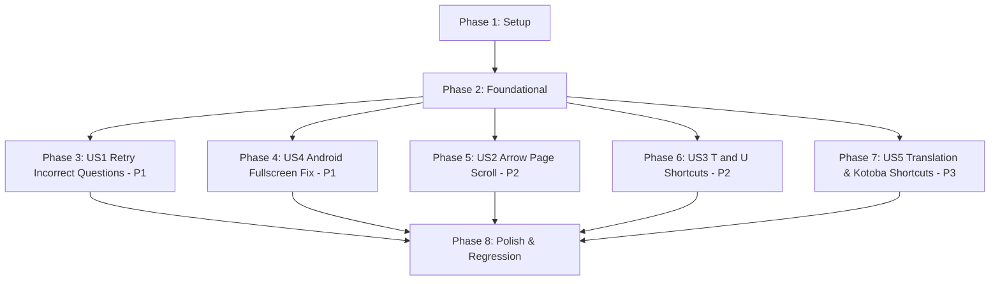

# Tasks: Practice Review Retry, Keyboard Enhancements & Android Fullscreen Fix

**Input**: Design documents from `specs/010-practice-review-retry-shortcuts-fullscreen/`  
**Prerequisites**: [plan.md](./plan.md), [spec.md](./spec.md), [research.md](./research.md), [data-model.md](./data-model.md), [contracts/](./contracts/), [quickstart.md](./quickstart.md)

**Tests**: Automated Node.js and Headless Chrome DevTools Protocol (CDP) test suites are included per Constitution Principle VII (Empirical Verification).

**Organization**: Tasks are grouped by user story to enable independent implementation and testing of each story.

---

## Format: `[ID] [P?] [Story] Description with file path`

- **[P]**: Can run in parallel (different files, no dependencies on incomplete tasks)
- **[Story]**: User story identifier mapping directly to `spec.md` (`[US1]`, `[US4]`, `[US2]`, `[US3]`, `[US5]`)
- Exact file paths are included in every task description.

---

## Phase 1: Setup (Environment & Baseline Checks)

**Purpose**: Validate repository environment, headless CDP automation, and test runner availability.

- [x] T001 Verify development environment, CDP automation port, and local server runner in `package.json` and `tests/test-feature-010-retry-incorrect.mjs`
- [x] T002 Verify active database stores and session schema readiness in `db.js` and `app.js`

---

## Phase 2: Foundational (Blocking Prerequisites)

**Purpose**: Core infrastructure and shared schema foundations that MUST be in place before user story implementations.

⚠️ **CRITICAL**: Complete this phase before implementing individual user stories.

- [x] T003 [P] Define CSS custom properties and base rules for breadcrumb bar and origin badges in `QUESTION-EDITOR-UPDATES.css`
- [x] T004 [P] Implement shortcut registry Schema v2 constants (`DEFAULT_SHORTCUTS_V2`) and migration routine in `app.js` (migrating `ssw_exam_shortcuts_v1` to `ssw_exam_shortcuts_v2`, preserving user customizations)
- [x] T005 Implement centralized input focus guard `isInputOrEditable(element)` in `app.js` to ensure all shortcuts are bypassed when candidate focus is inside text inputs, textareas, dropdowns, or contenteditable fields

**Checkpoint**: Foundation ready — user story implementation can now begin.

---

## Phase 3: User Story 1 - Retry Incorrect Questions Only (Priority: P1) 🎯 MVP

**Goal**: Enable candidates to launch an untimed practice CBT session containing solely questions answered incorrectly from a completed exam attempt, complete with top breadcrumb navigation and origin question badges.

**Independent Test**: Complete an exam with 3 wrong answers, 35 correct answers, and 2 skipped. In the Review tab, click `"Ulangi Jawaban Salah (3)"`. Verify a new Untimed Practice CBT launches with exactly those 3 questions, answers reset, header reading `Soal 1 dari 3`, origin badge `Asal: Soal #N`, and breadcrumb bar allowing immediate return to parent exam results while keeping parent exam history 100% immutable.

### Tests for User Story 1

- [x] T006 [P] [US1] Create automated test suite for US1 in `tests/test-feature-010-retry-incorrect.mjs` asserting wrong question filtering, zero-wrong guard toast, parent exam immutability, breadcrumb navigation, and `Asal: Soal #N` badges

### Implementation for User Story 1

- [x] T007 [US1] Implement incorrect question collection logic and `Ulangi Jawaban Salah (N)` action button rendering inside `.review-toolbar` in `app.js` per `specs/010-practice-review-retry-shortcuts-fullscreen/contracts/retry-session-contract.md`
- [x] T008 [US1] Implement retry session factory in `app.js` cloning only wrong questions with `originQuestionNumber`, setting `mode: 'practice'`, `timed: false`, `deadline: null`, `answers: {}`, and linking `originSessionId: parentSession.id`
- [x] T009 [US1] Implement persistent top breadcrumb bar (`.exam-retry-breadcrumb`) in `app.js` and `QUESTION-EDITOR-UPDATES.css` rendered during active retry CBT and on retry results screen
- [x] T010 [US1] Implement `return-to-parent-results` event action handler in `app.js` switching state cleanly back to the parent attempt's results screen (`state.resultId = originSessionId`, `state.page = 'result'`)
- [x] T011 [US1] Render origin reference badge (`.exam-question-origin-badge`, e.g. `Asal: Soal #N`) on active question cards in `app.js` and style in `QUESTION-EDITOR-UPDATES.css`
- [x] T012 [US1] Run `tests/test-feature-010-retry-incorrect.mjs` and verify all US1 acceptance scenarios pass

**Checkpoint**: User Story 1 (MVP) is fully functional and independently testable.

---

## Phase 4: User Story 4 - Fix Android CBT Fullscreen Button (Priority: P1)

**Goal**: Repair the CBT Fullscreen button (`⛶`) on Android mobile devices so tapping it triggers native `requestFullscreen()`, collapses browser chrome, synchronizes UI state via `fullscreenchange`, and falls back to CSS fill-screen strictly when unsupported or rejected.

**Independent Test**: In a mobile browser environment emulating Android Chrome, tap `⛶`; verify `shouldUseFillScreenFallback()` returns `false`, `requestFullscreen()` resolves, the button icon updates to `🗗`, and browser chrome collapses. Verify iOS Safari emulations fallback to `body.is-fill-screen`. Verify leaving CBT clears all fullscreen classes.

### Tests for User Story 4

- [x] T013 [P] [US4] Create automated test suite for US4 in `tests/test-feature-010-android-fullscreen.mjs` verifying native API detection on Android, iOS fallback, `fullscreenchange` synchronization, and teardown on exam exit

### Implementation for User Story 4

- [x] T014 [US4] Refactor `shouldUseFillScreenFallback()` in `app.js` to remove unconditional Android mobile UA / coarse pointer blocks, preserving native `requestFullscreen()` on Android Chrome / Samsung Internet and falling back strictly on iOS Safari or when native APIs are absent
- [x] T015 [US4] Update `toggleFullScreen()` in `app.js` to execute `requestFullscreen()` directly within user gesture activation with try/catch fallback to `state.examFillScreen = true` on security rejection per `specs/010-practice-review-retry-shortcuts-fullscreen/contracts/android-fullscreen-contract.md`
- [x] T016 [US4] Ensure `updateFullscreenUI()` and `fullscreenchange` listeners in `app.js` cleanly toggle `body.is-fullscreen`, update button icon `🗗`/`⛶`, and remove landscape orientation lock enforcement that disorients portrait users
- [x] T017 [US4] Add fullscreen cleanup call in `finishExam()` and navigation handlers in `app.js` ensuring `document.exitFullscreen()` is invoked and zero stale classes remain on `<body>`
- [x] T018 [US4] Run `tests/test-feature-010-android-fullscreen.mjs` and verify all US4 acceptance scenarios pass

**Checkpoint**: User Stories 1 and 4 are both fully functional and independently verified.

---

## Phase 5: User Story 2 - Arrow Up / Arrow Down Page Scrolling (Priority: P2)

**Goal**: Enable `ArrowUp` and `ArrowDown` keys to scroll the `.exam-workspace` container vertically by 80px increments without changing question index or interfering with text inputs.

**Independent Test**: Load a question with vertical overflow in CBT mode. Press `ArrowDown` 5 times; assert `scrollTop` increases by ~400px and question index does not change. Press `ArrowUp`; assert `scrollTop` decreases. Focus an input; assert arrow keys navigate text and do not scroll workspace.

### Tests for User Story 2

- [x] T019 [P] [US2] Create automated test suite for US2 in `tests/test-feature-010-keyboard-shortcuts.mjs` verifying `ArrowUp`/`ArrowDown` scrolling, continuous key repeat (`e.repeat === true`), boundary limits, and input focus bypass

### Implementation for User Story 2

- [x] T020 [US2] Implement `scrollQuestionUp` and `scrollQuestionDown` key handlers in `handleKeyDown()` in `app.js` scrolling `.exam-workspace` by ±80px with instant behavior
- [x] T021 [US2] Integrate `scrollQuestionUp` and `scrollQuestionDown` into the Keyboard Shortcuts modal UI (`renderExamSettingsModal()`) in `app.js` under "Navigasi Soal" with collision detection
- [x] T022 [US2] Run `node tests/test-feature-010-keyboard-shortcuts.mjs --filter=scroll` and verify all US2 acceptance scenarios pass

**Checkpoint**: User Story 2 is fully functional and independently verified.

---

## Phase 6: User Story 3 - T and U Keyboard Shortcuts (Priority: P2)

**Goal**: Implement single-letter shortcuts `T` (two-way Study List toggle) and `U` (Eye Reveal toggle in Untimed Practice mode only).

**Independent Test**: In Untimed Practice, press `T` on question 1; verify question is added to Study List. Press `T` again; verify question is removed from Study List. Press `U`; verify Eye Reveal turns ON. Press `U` again; verify Eye Reveal turns OFF. In Full Mock test, press `U`; verify nothing happens and zero answer keys leak.

### Tests for User Story 3

- [x] T023 [P] [US3] Add test cases for `T` and `U` shortcuts to `tests/test-feature-010-keyboard-shortcuts.mjs` verifying two-way study list toggle, Eye Reveal toggle in Practice, and zero leak in Full Mock mode

### Implementation for User Story 3

- [x] T024 [US3] Implement `toggleStudyList` action (`t`) in `handleKeyDown()` in `app.js` invoking `toggleStudyItem(currentExamQuestion())` with UI feedback and map marker synchronization
- [x] T025 [US3] Implement `togglePracticeReveal` action (`u`) in `handleKeyDown()` in `app.js` toggling `state.activeExam.practiceReveal` strictly when `mode === 'practice'`
- [x] T026 [US3] Register `toggleStudyList` and `togglePracticeReveal` in the Keyboard Shortcuts settings modal in `app.js` under "Alat Belajar"
- [x] T027 [US3] Run `node tests/test-feature-010-keyboard-shortcuts.mjs --filter=study-reveal` and verify all US3 acceptance scenarios pass

**Checkpoint**: User Story 3 is fully functional and independently verified.

---

## Phase 7: User Story 5 - Single-Letter Translation and Kotoba Shortcuts (Priority: P3)

**Goal**: Implement 8 dedicated single-letter shortcuts without modifier keys (`G`, `A`, `S`, `D` for Indonesian translations; `V`, `Z`, `X`, `C` for Kotoba vocabulary breakdowns) operating on question stems and options 1–3, respecting option shuffling, and safely ignored in Full Mock mode.

**Independent Test**: In Untimed Practice, press `G` to toggle stem translation; press `A`, `S`, `D` to toggle translations for options 1, 2, 3; press `V` to toggle stem Kotoba; press `Z`, `X`, `C` to toggle Kotoba for options 1, 2, 3. Verify option shuffling targets visual options 1..3. In Full Mock test, verify all 8 keys are safely ignored.

### Tests for User Story 5

- [x] T028 [P] [US5] Add test cases for the 8 translation/Kotoba shortcuts to `tests/test-feature-010-keyboard-shortcuts.mjs` verifying single-key activation, option shuffle resolution, 2-option safety, and Full Mock mode isolation

### Implementation for User Story 5

- [x] T029 [US5] Implement visual option resolver `getExamDisplayedOptions(s, q)` mapping index 0, 1, 2 to current visual option keys in `app.js`
- [x] T030 [US5] Implement dispatch handlers for `toggleQuestionTrans` (`g`), `toggleOption1Trans` (`a`), `toggleOption2Trans` (`s`), and `toggleOption3Trans` (`d`) invoking `toggleSelectiveTranslation()` in `app.js`
- [x] T031 [US5] Implement dispatch handlers for `toggleQuestionKotoba` (`v`), `toggleOption1Kotoba` (`z`), `toggleOption2Kotoba` (`x`), and `toggleOption3Kotoba` (`c`) invoking `toggleSelectiveKotoba()` in `app.js`
- [x] T032 [US5] Register the 8 new translation and Kotoba actions in the Keyboard Shortcuts settings modal in `app.js` under "Bantuan Bahasa & Kosakata"
- [x] T033 [US5] Run `node tests/test-feature-010-keyboard-shortcuts.mjs --filter=trans-kotoba` and verify all US5 acceptance scenarios pass

**Checkpoint**: All five user stories are independently implemented and verified.

---

## Phase 8: Polish, Multi-Viewport Verification & Regression Testing

**Purpose**: Cross-cutting quality checks, WCAG AA contrast verification, responsive viewport parity, and full regression testing across previous features.

- [x] T034 [P] Audit WCAG AA contrast (`>= 4.5:1`) and visual cadence on `.exam-retry-breadcrumb` and `.exam-question-origin-badge` in `QUESTION-EDITOR-UPDATES.css`
- [x] T035 [P] Verify desktop (1440px) and mobile (390px) responsive layout parity via headless CDP screenshot captures in `tests/test-feature-010-retry-incorrect.mjs`
- [x] T036 Run full regression suite (`test-feature-009-shortcuts.mjs`, `test-practice-selective-kotoba.mjs`, `test-feature-009-practice-ergonomics.mjs`) ensuring zero regressions to existing features
- [x] T037 Execute `git diff --check` and verify codebase hygiene, comment preservation, and zero whitespace errors across all touched files

---

## Dependencies & Execution Order

### Phase Dependencies



- **Setup (Phase 1)**: Can start immediately.
- **Foundational (Phase 2)**: Depends on Phase 1; blocks all user stories.
- **User Story Phases (Phases 3–7)**: Can proceed in priority order (US1 → US4 → US2 → US3 → US5) or in parallel once Foundational is complete.
- **Polish & Regression (Phase 8)**: Depends on all user stories being complete.

---

## Parallel Execution Examples

### User Story 1
```bash
# Launch test creation in parallel with CSS styling:
Task: "Create automated test suite for US1 in tests/test-feature-010-retry-incorrect.mjs"
Task: "Define CSS custom properties and base rules for breadcrumb bar and origin badges in QUESTION-EDITOR-UPDATES.css"
```

### User Story 4
```bash
# Launch Android fullscreen test while preparing UA refactor:
Task: "Create automated test suite for US4 in tests/test-feature-010-android-fullscreen.mjs"
Task: "Refactor shouldUseFillScreenFallback() in app.js"
```

### User Stories 2, 3, 5 (Keyboard Shortcuts)
```bash
# Implement action dispatchers in app.js while updating shortcut modal registration:
Task: "Implement scrollQuestionUp and scrollQuestionDown key handlers in handleKeyDown() in app.js"
Task: "Implement toggleStudyList and togglePracticeReveal actions in handleKeyDown() in app.js"
Task: "Implement dispatch handlers for toggleOptionNTrans and toggleOptionNKotoba in app.js"
```

---

## Implementation Strategy

### MVP First (User Story 1 & User Story 4)
1. Complete Phase 1: Setup (T001–T002).
2. Complete Phase 2: Foundational (T003–T005).
3. Complete Phase 3: User Story 1 (T006–T012).
4. Complete Phase 4: User Story 4 (T013–T018).
5. **Checkpoint**: Targeted incorrect question review and Android fullscreen work end-to-end.

### Incremental Feature Expansion
1. Add User Story 2 (Arrow key page scroll, T019–T022).
2. Add User Story 3 (`T` & `U` action shortcuts, T023–T027).
3. Add User Story 5 (Single-letter translation & Kotoba shortcuts, T028–T033).
4. Complete Phase 8: Multi-viewport audit and full regression verification (T034–T037).
